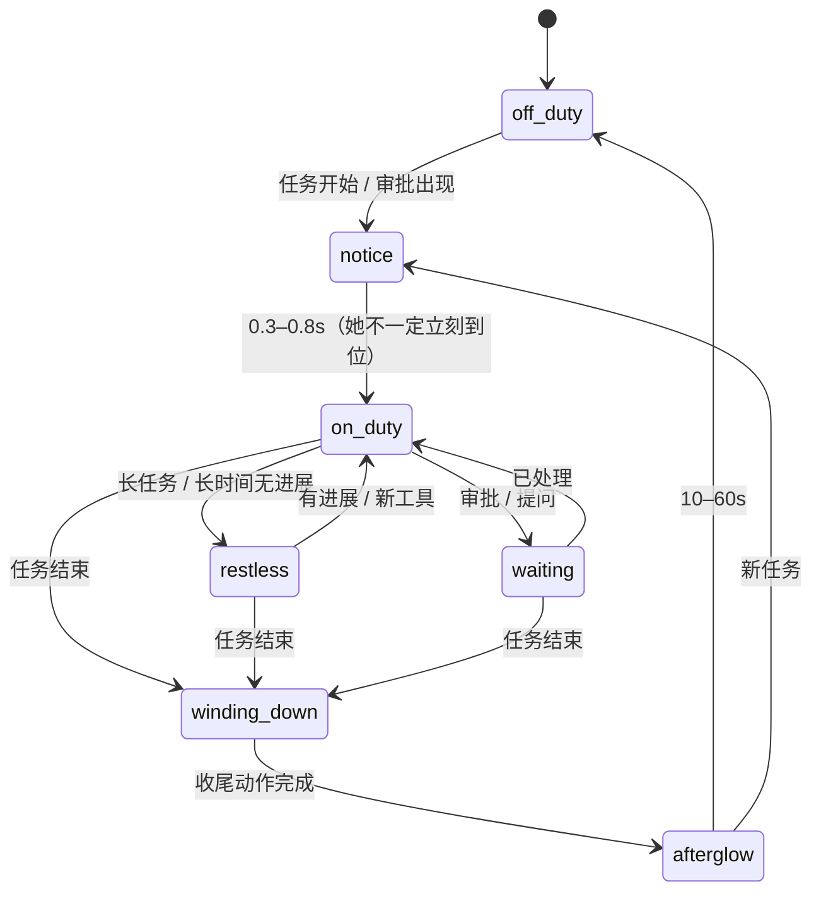
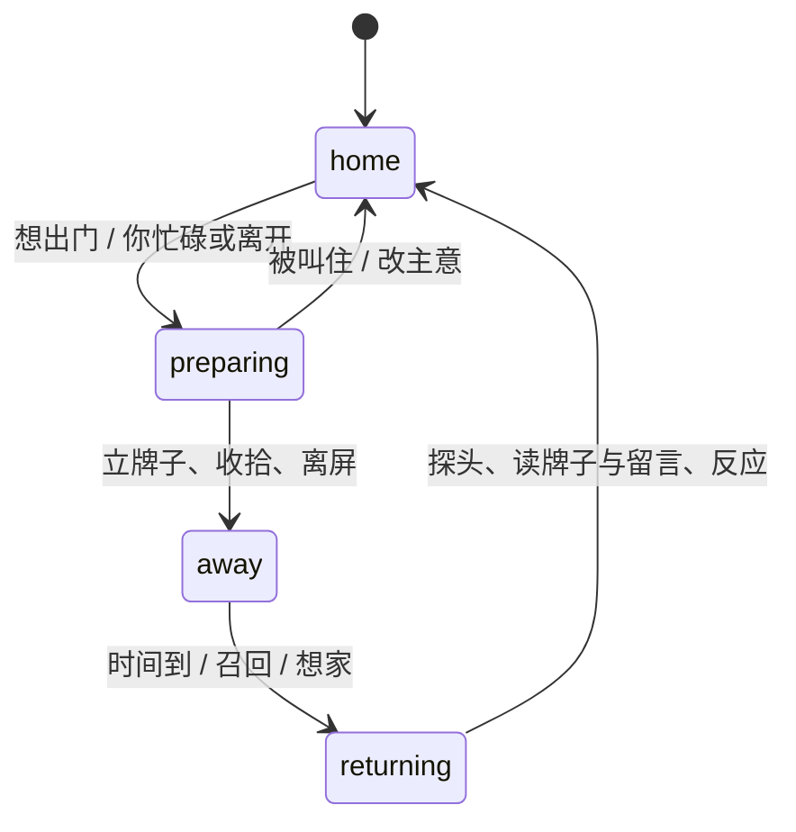

> 历史快照：2026-10-19 整理归档。下文的阶段、默认入口、限制和下一步属于形成时的状态；当前执行依据为[生活感开发状态](../../aliveness-development.md)。概念稿的 P1–P3 排序已由当前七阶段路线替代。

# 大肥鱼 · 生活感概念设计稿

> **状态**：v0.1 概念稿（未实现，待产品完善后交实现）
>
> **一句话**：她是一个在桌面小镇里有家、有班表、会出门、会留字条、有脾气的小邻居。
>
> **定位**：任务时是伙伴，空闲时是有自己生活的小人（下称“伙伴 + 邻居”）。
>
> **读者**：产品、实现、美术、测试。
>
> **边界**：本稿描述目标体验与机制，不是行为契约；不改变 [自主陪伴契约](../../companionship-contract.md) 等现行文档。落地前需新增《生活空间契约》《陪伴叙事契约》，并单独评审与现行契约的差异（见第 18 节）。本稿暂不加入 [文档索引](../../README.md)，定稿前不视为现行行为。
>
> **怎么用**：第 0–3 节给产品定调；第 6–12 节是体验与机制；第 13–17 节给实现与测试；第 14 节给美术；第 18–19 节给契约评审与决策。

---

## 目录

1. 现状与问题
2. 目标体验与非目标
3. 设计公理
4. 参考：旅行青蛙（借什么，不借什么）
5. 系统总览
6. 空间：桌面小镇
7. 时间：上下班与收尾
8. 出门与留言（旅行青蛙循环的桌面版）
9. 声音：主动搭话与请求
10. 人格：她是谁
11. 情绪天气
12. 关系：行为权限
13. 数据、状态与模块建议
14. UI、交互与美术需求
15. 隐私、安全、可访问性、性能
16. 验收：怎么判断“活了”
17. 分期路线
18. 与现行契约的差异
19. 开放问题
20. 待完善清单

附录 A 台词样例 · 附录 B 小剧场 · 附录 C 术语表

---

## 0. 已定 / 待定 / 不做（决策记录）

| 主题 | 已定 | 待定 |
|---|---|---|
| 定位 | 伙伴 + 有自己生活的桌面邻居 | 两种成分随关系、时段如何配比 |
| 空间 | 全屏活泼；避开工作区；避免单轴移动 | 满屏默认“贴边”还是“出门”；边带宽度 |
| 主动性 | 会主动搭话、提小请求 | 台词库、频率曲线、请求种类 |
| 任务结束 | 有收尾，再回自己的生活 | 收尾时长与结局分化细节 |
| 工作区 | 自动识别 + 手动补充 | 自动来源、手动设置形态 |
| 出门 | 时长自由；必须有痕迹；可以给她留言 | 长出门的默认开关与上限 |
| 性格 | 用性格/模式代替固定频率 | 人格卡数量、是否漂移、是否由角色包声明 |
| 参考 | 旅行青蛙的异步循环 | 明信片/小发现是否做 |
| 不做 | 电子宠物鸡、第二个通知中心、always-on 表演、假装懂任务内容 | — |

---

## 1. 现状与问题

现行实现里，她是一个**响应系统**，不是一个“在过日子”的角色：

1. **默认没有自主行为**。桌面页把角色引擎的随性空闲关掉（`roam: 'off'`），引擎自带的空闲决策不运行。你不碰她时，她只剩眨眼、呼吸、随机瞟一眼、跟随鼠标。
2. **唯一的自主日常是一台节拍器**。`web/npc-life.js` 是固定相位机：小窝 7 秒 → 准备 1.8 秒 → 走到活动段 15% / 50% / 85% 三个固定点之一 → 观察 6.5 秒 → 回来 → 坐 10 秒。看一圈就能背出下一圈；日常词汇只有 `look / nod / stand / sit / walk`，表情库绝大多数只在任务事件里出现。
3. **情绪是标签，不是过程**。`mood → word → face` 一对一，表情约 3.2 秒后归零，没有惯性、余韵、混合。
4. **没有“她自己的生活”**。所有行为都以用户或任务为轴；没有“不为你表演”的时刻，因此“伙伴感”只在任务时成立，空闲时就成了摆设。

结论：她需要**理由、生活、痕迹**，而不是更多动作。

## 2. 目标体验与非目标

### 2.1 目标体验

- **你工作，她上岗**：她能读懂任务节奏，替你留意、守着、高兴。
- **你休息，她过日子**：整理小窝、发呆、探索、练习、打盹、出门。
- **彼此不在时，都有痕迹**：牌子、留言、回信、小东西；思念有物证。
- **你能“撞见”她**：她做与你无关的事，被看见会害羞，不为你表演。
- **你能读懂理由**：先看再走、犹豫、失败、改主意——行为有前因后果。
- **一天里不完全一样，但始终是她**：稳定的性格 + 每日状态 + 情绪天气。

### 2.2 非目标

- 不做喂食、清洁、数值养成的电子宠物鸡。
- 不做第二个通知中心；提醒仍走信封与系统通知。
- 不做 always-on 表演；静止是选择。
- 不读屏、不读键、不读其他应用内容，不假装懂任务内容。
- 当前阶段不调用模型生成日常台词（见 19 节开放问题）。

## 3. 设计公理（八条）

1. **先有理由，再有动作**：先看目标再走，做完有结果。
2. **允许不完美**：犹豫、走错、够不着、放弃、改主意、慢半拍。
3. **分层叠加**：呼吸、视线、重心、鳍与呆毛常驻；行为是叠加，不是状态替换。
4. **注意力有限**：会注意你，也会看丢、走神、第一声没听见。
5. **情绪有惯性**：累积、衰减、混合、余韵，影响动作与语气。
6. **有自己的事**：最好的“活”是被你撞见她在忙自己的事。
7. **多时间尺度**：秒级微动作、分钟级情绪、小时级精力、天级节律。
8. **留白**：静止是选择；不要用抖动冒充生命。

---

## 4. 参考：旅行青蛙（借什么，不借什么）

《旅行青蛙》的核心循环是：**准备 → 出门 → 等待 → 明信片/消息 → 归来伴手礼**。玩家不能控制目的地，只能准备与等待；缺席时由明信片承载思念，归来时由伴手礼兑现记忆。这个循环与“桌面邻居”高度同构。

| 旅行青蛙机制 | 为什么有效 | 桌面版对应 | 取舍 |
|---|---|---|---|
| 玩家只准备，不控制去向 | 制造“她有自己的生活” | 你只能留话、设地图、调人格，不能命令她去哪 | **保留** |
| 出门无实时画面，只有明信片 | 思念 + 惊喜 | 她离屏/去别的屏；牌子、留言、偶发回信 | **保留**（任务开始会召回） |
| 归来带伴手礼、照片、新朋友 | 记忆的物证 | 小发现/手绘明信片/回信 | **保留**，轻量，不做收集数值 |
| 三叶草、商店、道具 | 等待期的参与感 | 不做货币；用留言、贴纸、地图设置代替 | **不借** |
| 随机目的地、无失败 | 无压力、低门槛 | 出门去屏幕外/别的屏/小窝以外 | **保留无失败** |
| 低频、异步、不催 | 不打扰 | 只在你空闲时发生；任务优先 | **强化** |
| 玩家可能觉得无事可做 | 风险 | 工作陪伴兜底；出门不是唯一内容 | **风险控制** |

### 4.1 关键改造

- **任务优先与召回**：她可以在无任务时长出门；一旦任务开始/审批出现，她会被召回（或在牌子上留“马上回来”）。不能因为“旅行”让产品核心功能缺位。
- **明信片不是截图**：隐私边界内不截屏。她带回来的是**她自己的手绘想象**（美术资产）+ 一句话。
- **不做经济系统**：没有货币、抽奖、限时、FOMO。
- **等待必须有物证**：牌子、留言、痕迹；否则“不在”就只是“消失”。

---

## 5. 系统总览

```
宿主事实（任务/审批/完成/错误/输入活跃/本地时间/屏幕几何）
        │
        ▼
[L1 世界]  地图、工作区、门槛、栖木、屏幕边缘、多屏
        │
        ▼
[L2 她]    需求/情绪天气/人格/关系/每日状态
        │
        ▼
[L3 议程]  选择目标 → 执行 → 结果/失败 → 重规划
        │
        ▼
[L4 表达]  动作/表情/声音/台词/物件（牌子、留言、小发现）
        │
        ▼
[L5 交互]  串门/搭话/小请求/邀请/留言/召回
```

**分层原则**

- **单一议程**：全产品只保留一个自主调度入口（替换现有 `npc-life.js` 的相位机，而不是再叠一套）。
- **纯策略**：每层都是纯函数，时钟、随机源、几何、宿主事实由外部注入，可重放、可断言。
- **表达层不决策**：只把议程输出映射到现有 body/figure 词汇，保持上游运行时不变。
- **持久化最小化**：只存关系、人格、地图、留言/牌子、小发现、今日安静等；日常意图与情绪不补算。

---

## 6. 空间：桌面小镇

### 6.1 三种地形状态

| 地形状态 | 触发 | 她怎么活 |
|---|---|---|
| **开阔态** | 窗口小、桌面留白多 | 全屏活动：空地、栖木、边缘环；探索、追光、串门 |
| **收缩态** | 窗口占半屏 | 沿窗口边缘走，像沿墙根；活动区变成 L 形 |
| **满屏态** | 窗口最大化/全屏 | 边缘带 + 屏幕外 + 探头 + 留痕；不硬挤 |

### 6.2 领地与门槛

```
┌─ 栖木 / 看台（顶边、角落、屏幕边） ──────────┐
│   ┌──────────────┐        空地               │
│   │  你的工作区   │      ┌──────┐            │
│   │  (Harness)   │      │ 小窝 │            │
│   └──────────────┘      └──────┘            │
│        ↑ 门槛：她说话只到这里为止             │
│   边缘环线（左右 + 底部）+ 地平面             │
└────────────────────────────────────────────┘
```

- **家（小窝）**：固定角落/边缘；睡觉、整理、留牌子的地方。每块屏最多一个家。
- **栖木**：可停留的高点/边点（屏幕角、边缘、小窝顶）。每块屏 2–5 个，给“高低差”和目的。
- **空地**：桌面留白，散步、追光、打滚。
- **边缘环**：贴屏幕四边、不覆盖工作区的闭环走廊。
- **工作区**：Harness 窗口 + 缓冲；自动识别 + 手动补充。
- **门槛**：工作区外沿的礼貌线；她最多到线外，说话、偷看、等待都在门外。
- **禁区**：手动排除（任务栏、系统图标、你不想她去的区域）。

### 6.3 移动语法（非单轴的关键）

不是换路径，而是换**动作类型**：

| 动作 | 地形 | 用途 | 备注 |
|---|---|---|---|
| 走 / 跑 | 地平面 | 日常移动 | 已有 |
| 跳上 / 跳下 | 栖木、边缘 | 制造高低差 | 有预备、落地缓冲 |
| 贴边爬 / 挂 | 屏幕边缘 | 垂直移动 | 半个身子贴边，不遮内容 |
| 滑翔 / 扑腾 | 空地 | 跨区域 | 鲸鱼身份；短距离弧线 |
| 探头 | 工作区边缘 | 不打扰的陪伴 | 只露局部 |
| 出门 / 回屏 | 屏幕边缘 | 缺席与归来 | 牌子/痕迹 |
| 绕路 / 换路 | 任意 | 避开鼠标、禁区 | 不横穿工作区 |
| 停–看–走 | 任意 | 有意图的移动 | 不做直线导航 |

**路径风格**：弧线、停顿、张望；偶尔走偏、回头、被吸引。禁止“直线冲刺”和“瞬移回原位”。

### 6.4 避让模型

- 工作区矩形 + 光标“社交距离环” + 气泡/面板，三者都不踩。
- 你打字、阅读、开会、发送中 → 她退到门槛外、栖木上或回家，但**保持可见的存在**（边角露半身、偶尔探头），不是消失。
- 你空闲、光标离开 → 她才敢进空地。
- **满屏降级**：没有空地时只剩边缘与栖木；再没有空间就出门（留牌子），只用探头、微声和气泡陪你。
- **优先级**：手动禁区 > 手动门槛 > 自动工作区 > 默认边缘。**不遮挡永远第一。**

### 6.5 世界呼吸

工作区是动态的：窗口一大，她的世界缩；窗口一小，世界张开。她会对这个变化做出反应——往边上挪、探头看、被“挤”到角落时小小的无奈、你腾出空间后慢慢走进来。**世界跟着窗口一起呼吸**，这是低成本、高感知的生命信号。

### 6.6 她的地图与设置

- **自动**：Harness 窗口矩形（只读几何）、窗口是否最大化/全屏（只读状态）、光标热区、输入活跃度。
- **手动**：门槛距离、边缘带宽度、禁区、家在哪块屏/哪个角、满屏默认“贴边/出门”。
- 设置里给一张**“她的地图”**：可视化允许区域、门口线、禁区；每块屏一份。
- 与旧设置的迁移：`npcHome/npcRange` 映射为“家位置 + 默认活动野心”，旧配置不丢失（具体映射见实现评审）。

### 6.7 多屏

- 主屏安家；其他屏是“邻居家”。
- 跨屏用**边缘穿越**（从这边出去，从那边进来），不做瞬移。
- 手动可以把家搬到某块屏；新屏首次使用时由用户确认或默认右下角。

### 6.8 硬约束

- 不覆盖 Harness 内容、气泡、收件箱、聊天面板、系统关键 UI。
- 不读取任何窗口内容；只使用几何与公开状态。
- 覆盖窗口点击穿透；仅宠物命中区与牌子/Card 可交互。
- 角色尺寸始终由用户设置决定；不因空间变化自动缩放。

---

## 7. 时间：上下班与收尾

### 7.1 两个时钟

- **你的时钟**：任务、工具、审批、完成、报错——快、碎、由 Harness 驱动。
- **她的时钟**：精力、兴致、困意、想玩、想回家——慢、连续、由需求驱动。
- **活的瞬间 = 两个时钟打架**：她正想回窝，你开新任务，她停半拍、叹口气、转回来；她刚打盹，完成通知来了，一个激灵。

### 7.2 上下班状态机



- 她不在场时任务开始：先登记 `notice`，触发召回；回来后进入 `on_duty`。
- 优先级：审批/错误 > 任务进行 > 日常；任务表情优先于她自己的情绪（沿用现行契约）。
- 上下班不使用弹窗、不抢焦点；只通过身体、微声、牌子与气泡表达。

### 7.3 宿主事件 → 她的读法

| 宿主事实 | 她的读法 | 表现方向 |
|---|---|---|
| 新任务 / 思考中 | 开始忙了 | 上岗、托腮、视线转向任务方向 |
| 调用工具 | 他在做事 | 好奇观察，不打扰 |
| 长生成 / 无进展 | 有点久 | 坐不住、换姿势、偷偷打盹，不催 |
| 审批 / 提问 | 需要你 | 守小信封、推一推、回头看 |
| 完成 | 结束了 | 确认 → 庆祝 → 收工 |
| 失败 / 中断 | 出问题了 | 愣半拍 → 看你 → 担心 → 安静陪 |
| 新回复 / 未读 | 有新东西 | 看一眼信封，偶尔好奇 |
| 你在输入 | 别打扰 | 退让、安静 |
| 你长时间不在 | 他走了 | 回自己的生活、出门、打盹 |
| 深夜 | 他还没睡 | 安静、打盹、值夜 |
| 长时间无任务 | 今天闲 | 串门、探索、小请求、发呆 |

### 7.4 收尾三拍（定 → 情 → 收）

| 结局 | 定 | 情 | 收 |
|---|---|---|---|
| 成功 | 确认结果 | 开心、转圈、拍鳍 | 伸懒腰 → 余韵 → 回家 |
| 部分完成 | 确认仍在进行 | 鼓励、守在旁边 | 保持关注但放松 |
| 失败 | 愣半拍 | 先看你 → 担心 | 安静陪你，不强行正能量 |
| 中断 | 被“闪”一下 | 困惑、看你 | 整理情绪 |
| 审批未决 | 确认还在等 | 守信封、看你 | 保持等待态 |

**时长随任务长度与强度缩放**：短任务 0.5–2 秒；中等 2–5 秒；长任务 5–15 秒 + 余韵。收尾不阻塞任何 UI。

**余韵**：收尾后 10–60 秒的“半下班”状态——还会瞟一眼屏幕，慢慢松下来，再决定回家/串门/继续自己的事。

**被打断**：新任务来了立刻切回，但残留情绪（还带着得意或担心）——非常像人。

### 7.5 一日节律

- **早晨**：从窝里出来、伸懒腰、沿边缘巡视、在门槛打招呼。
- **工作时段**：上岗；长任务换栖木、探头、坐不住。
- **午间**：找地方打盹，或回窝。
- **下午**：探索、练习、玩；低频串门。
- **傍晚**：收工仪式。
- **深夜**：安静、打盹、值夜；只在审批/错误时靠近。
- **休息日**：更活泼、更常出现在空地。

### 7.6 每日状态签

每天第一次启动时，按本地日期抽一个“今日状态”（精神 / 犯困 / 兴奋 / 想冒险 / 想安静），微调她的行为权重与台词。**人格不变，今天不同**——解决“性格定死又会变呆”的矛盾。只记录日期与签，不积累数值。

---

## 8. 出门与留言（旅行青蛙循环的桌面版）

### 8.1 触发与时长

- **近门（1–5 分钟）**：无任务、输入空闲、你在浏览/短暂离开；她去屏幕外或别的屏转一圈，立牌子，随时可召回。
- **远门（10 分钟–数小时）**：无进行中任务、无待处理审批、长时间无输入；适合你离开电脑或休息日。默认建议关闭或由用户开启。
- **任务召回**：任务开始 / 审批出现 → 召回（近门秒级回来；远门先更新牌子“马上回来”，随后回来）。同时提供手动召回（菜单/托盘“叫她回来”）。
- **无惩罚**：她不在不扣分、不错过成长；你不在她也不失落。

### 8.2 三件套

1. **小牌子**（她走时留下）：立在家门口或屏幕边缘，一行她的口吻 + 一个涂鸦。状态：`出门中` / `有留言` / `回来了` / `已隐藏`。可点击、可拖动、可隐藏；不挡内容。
2. **留言卡**（你给她留的）：点牌子 → 小卡片 → 写一行字或贴一个表情/贴纸。本地保存；她回来读。
3. **痕迹**（她不在时桌面仍有她）：小窝、灯、她出门前留下的小东西；桌上可能多出她之前捡的“星星/贝壳/泡泡”。

### 8.3 留言怎么用：异步笔友

- 你写 → 她回来读 → 她回信（预置语气 + 引用你的话）→ 你可能不在 → 回信留在牌子上 → 你回来看到。
- 慢速、异步、**不要求即时回应**，与聊天面板的即时性完全分开。
- 她记得最近几次留言的关键词（本地轻量），回信能呼应；不做长期对话记忆。
- 回信先做离线模板；是否接模型见开放问题。

### 8.4 回来仪式

从边缘探头 → 看到牌子 → 读留言（停一下、歪头）→ 反应（开心/害羞/把牌子翻过来）→ 来找你（在门槛外）或先回窝整理。

- 你在忙：她读完留言看你一眼，先回窝，不打扰。
- 你不在：她把回信留在牌子上；你回来时牌子显示“她回来了 · 给你留了话”。
- 她带了小发现：放在小窝旁，作为痕迹。

### 8.5 小发现 / 明信片（Phase 3，可选）

- 她带回来的是**手绘的想象明信片**（美术资产），不是屏幕截图。
- 收进一个小相册，不计数、不兑换、不排行。
- 频率极低，与远门绑定。

### 8.6 不制造内疚

- 台词不指责、不催：“你回来啦”而不是“你怎么才回来”。
- 你忘了留言，她不失落；她出去玩得很开心，回来分享。
- 不做限时、FOMO、连续登录奖励。

### 8.7 出门状态机



数据建议：`{ phase, kind: 'near'|'far', leftAt, dueRange, recallable, reason, signState, noteCount }`。运行期为主；牌子状态与留言需持久化。

### 8.8 小剧场

> 你最大化窗口 → 她收拾小窝、立牌子、从右边滑出去 → 你工作 → 你在牌子上留“早点回来” → 晚上退出全屏，发现她已经回来，牌子上是她的回信和一颗小东西。

---

## 9. 声音：主动搭话与请求

### 9.1 三种通道

| 通道 | 期待 | 例子 | 被忽略时 |
|---|---|---|---|
| **自言自语** | 不需要回应 | “唔，今天风好大。” | 继续做自己的事 |
| **对你说话** | 邀请，不要求 | “忙完啦？” | 自己走开，不尴尬 |
| **小请求** | 需要回应，可拒绝 | “陪我看三秒那边？” | 自己去做，或改天再问 |

说话位置：走到**门槛外**再开口，不进工作区；说完不走，等你一眼。

### 9.2 内容域

**可说**：她自己的事、你的状态（不评价）、共同的事（任务/审批/完成，只读公开事实）、时间与节律、关系阶段。

**不可说**：任务内容、屏幕内容、其他应用、评价你的工作、催促与内疚绑架、编造她知道的事。

### 9.3 礼仪硬规则

- 你打字、阅读、发送中、面板打开、全屏专注 → 不说话、不靠近。
- 气泡最多 1 个；不抢焦点；自动收起；不覆盖面板；点击穿透规则与牌子一致。
- 夜间只留微声；提供“今天安静”与总音量。
- 连续被忽略 → 降频、退回自己的生活；给台阶，不追问。

### 9.4 预算：从性格里长出来

```
说欲 = 话量 × 关系亲近 × 今日状态 × 场合系数
```

- 不是“一天最多 N 次”。话痨一天可以说很多，但总在你方便时；书虫可能一天只说一句，但那句很准。
- 礼仪是硬约束；另设一条安全上限（如每小时绝对上限）防止 bug 刷屏，但调参不应成为人格本身。
- 关系越熟，允许越没分寸——陌生只打招呼，朋友才会开玩笑。

### 9.5 小请求库（都可拒绝、不催）

| 请求 | 触发 | 她怎么做 | 你回应 | 你忽略 |
|---|---|---|---|---|
| 陪我看三秒那边 | 你空闲、她在门口 | 带你去屏幕角落看她“发现的东西” | 一起看，她开心 | 自己去看，回来分享 |
| 一起伸个懒腰 | 你久坐 | 她伸懒腰，等你 | 跟着做，她得意 | 自己伸，不催 |
| 帮我挑个配色 | 你在外观页或空闲 | 打开外观入口给你看 | 一起挑 | 自己换一个，过会儿给你看 |
| 我出去一下，帮我看家？ | 近门出门前 | 立牌子、指向门口 | 点头/点击 | 她照常出门，留牌 |
| 来看看我找到的地方 | 远门回来 | 领路到某角落 | 跟去 | 她自己待着 |
| 摸摸头 | 关系熟悉 | 凑近、低头 | 抚摸 | 自己走开 |

### 9.6 邀请与门槛

- 门槛可以被她尊重，也可以被你打开：点她、拖她进来、气泡上的“进来吧”。
- 她不主动打开面板；涉及面板时只做“指向/邀请”，由你点击。

### 9.7 台词风格

- 短（≤ 15 字）、口语、有口癖（“唔 / 呐 / 嘿”），不播报状态，不堆表情符号。
- 同一句 30 分钟内不重复；按场景槽位组合（时间、她的事、共同事件、关系）。
- 中英双语分开写；不翻译会话内容。
- 示例见附录 A。

---

## 10. 人格：她是谁

### 10.1 三层

- **人格（稳定）**：她是谁。
- **今日状态（每天）**：今天的她。
- **场合（实时）**：正在工作、你在专注、深夜、刚被吓到。

### 10.2 六个维度

| 维度 | 低 | 高 |
|---|---|---|
| 好奇心 | 只走熟路 | 到处探索、问题多 |
| 话量 | 安静 | 主动搭话、分享多 |
| 黏人度 | 各过各的 | 常靠近、常串门 |
| 玩心 | 认真、少玩 | 追光、转圈、小恶作剧 |
| 胆量 | 易受惊、谨慎 | 敢探头、敢靠近 |
| 慵懒 | 精神、爱动 | 爱坐、爱打盹、走得慢 |

### 10.3 人格卡（内置预设，可微调）

| 人格 | 一句话 | 行为差异 |
|---|---|---|
| **好奇宝宝** | 什么都想看看 | 探索半径大、出门多、问题多 |
| **安静书虫** | 陪着就好 | 话少、靠近但不打扰、常发呆 |
| **小话痨** | 有说不完的话 | 搭话多、分享多、小请求多 |
| **小傲娇** | 才不是想你呢 | 嘴上拒绝、身体靠近、被摸别过头 |
| **懒懒的** | 能坐着不站着 | 打盹多、走得慢、晒太阳，被逗会精神 |
| **认真小助手** | 工作时要认真 | 工作态投入、收尾完整、玩心少 |

### 10.4 同一事件，不同性格

任务完成时：话痨转圈喊你；书虫眼睛亮一下、尾巴慢慢摆；傲娇假装没看见，过两秒偷偷瞄你；懒懒的从窝里抬起一只鳍又放下。**同一套事件，长出不同的魂。**

### 10.5 相处漂移（轻、慢、可逆）

- 你常回应 → 她更敢提请求、更常串门；你常忽略 → 她更安静、更多自己玩。
- 不做可见数值、不做等级、不做刷取；变化以“行为权限”体现。
- 可“锁定人格”防止漂移；缺席/拒绝不扣分。

### 10.6 角色包声明（API 2 扩展设想）

- 角色清单可选声明默认人格（“这只鱼是懒懒的”），玩家可在预设上微调。
- 同角色不同人格可成为社区分享点。
- 缺省人格由内置大肥鱼提供；无声明时用默认卡。

### 10.7 陪伴力度（房间的灯）

提供 **安静 / 日常 / 热闹** 三档，只调节整体在场感与主动性，不改变她是谁。与现行 `companionship` 的关系需在契约评审中定义。

---

## 11. 情绪天气

- **三维**：效价（好/坏）、唤醒（平静/激动）、精力（充沛/疲惫）。
- **会累积、会衰减、会混合**：被吓到后 20–60 秒更警觉；被夸后尾巴摆更久；好奇+紧张 = 想靠近又缩回；困+被打扰 = 委屈。
- **影响**：动作速度、步幅、抬头角度、叹气/微声频率、反应延迟、台词语气。
- **余韵**：事件结束后保留一段时间的“后劲”，而不是立刻归零。
- **与任务表情的关系**：任务表情优先（现行契约）；任务结束后的收尾与余韵由情绪天气接管。
- **不惩罚**：没有饥饿、掉心情、离线衰减；情绪只影响表现，不影响功能。

---

## 12. 关系：行为权限

| 阶段 | 行为权限 | 小仪式 |
|---|---|---|
| **陌生邻居** | 只打招呼；请求很少；不进入工作区 | 点头 |
| **熟人** | 会串门、记得你的习惯、开始分享 | 挥鳍 |
| **朋友** | 你忙时安静陪着、你累时来提醒、偶尔玩笑 | 每天第一次见面碰鳍 |

- 不显示数值；计数只用于解锁；离线不补算；缺席和拒绝不扣分。
- 新解锁以“行为权限”表达，而不是“好感度 +1”。
- 留言、小发现不计入成长，避免刷取（具体由产品定）。

---

## 13. 数据、状态与模块建议

### 13.1 运行期状态（不持久化，重载重建）

- 空间：工作区、可用区域、当前地形状态、她的位置/朝向/运动。
- 她的状态：情绪天气、需求、今日状态签（可轻持久化日期+签）、议程目标。
- 班表：shift 阶段、开始时间、结局、余韵计时。
- 出门：当前 trip（近/远门、离屏时间、召回状态）。
- 社交：说欲、最近说话、忽略计数、当前待回应请求。
- 回忆：最近行为、最近地点、冷却。

### 13.2 持久化（有界、本地）

- 关系（沿用现有存档，扩展解锁行为）。
- 人格卡与六维微调、锁定。
- 每块屏的地图（家、栖木、门槛、禁区、满屏模式）。
- 牌子状态与留言（条数/长度有界，可删除）。
- 小发现/明信片（可选，有界）。
- 今日安静、陪伴力度、音量等偏好。

### 13.3 建议模块边界（概念，不指定代码）

| 模块 | 职责 | 依赖 |
|---|---|---|
| `world` | 空间、地形、门槛、路径可行性 | 几何、输入 |
| `map` | 地图设置持久化 | 存储 |
| `affect` | 情绪天气的累积/衰减/混合 | 时钟 |
| `personality` | 维度、人格卡、漂移、每日签 | 关系、日期 |
| `agenda` | 目标选择、执行、失败重规划 | world/affect/personality |
| `shift` | 上下班与收尾 | 宿主任务事实 |
| `trip` | 出门/召回/回归 | 宿主输入、议程 |
| `social` | 说话/请求/预算/退避 | 人格、场合、关系 |
| `notes` | 牌子/留言/回信持久化 | 存储 |
| `expression` | 映射到 body/figure 词汇 | 现有运行时 |
| `hostAdapter` | 事件、几何、输入、通知 | 宿主 |

### 13.4 可测试性

- 所有策略纯函数；时钟、随机源、几何、任务事实注入。
- 每个行为可用“场景脚本 + 种子”重放：给定一天的输入序列，输出稳定的事件时间线。
- 状态机、预算、避让、召回、收尾均可单测；遮挡与布局做自动化像素/区域断言。
- 不新增常驻定时器；单一 tick 驱动。

---

## 14. UI、交互与美术需求

### 14.1 UI 清单

- **小牌子**：出门中 / 有留言 / 回来了 / 隐藏；点击打开留言卡；可拖动、可隐藏。
- **留言卡**：一行文字 + 贴纸；历史记录；删除；本地存储提示。
- **她的地图**：每屏一份；画允许区域、门槛、禁区、家、满屏模式。
- **人格**：六张卡 + 高级微调 + 锁定 + “每日状态”开关。
- **陪伴力度**：安静 / 日常 / 热闹；今天安静；叫她回来。
- **气泡规则**：最多 1 个；不抢焦点；可忽略；不覆盖面板；贴边自适应。
- **托盘/菜单**：召回、今天安静、留言入口（可选）、地图入口。

### 14.2 美术/动画需求（初步）

| 资产/动作 | 用途 | 备注 |
|---|---|---|
| 贴边爬/挂 | 垂直移动 | 可先用“贴边滑行”简化 |
| 探头（半身） | 工作区边缘 | 只露局部，不遮内容 |
| 滑翔/扑腾 | 跨空地 | 可复用 air 帧改造 |
| 跳上/跳下 + 落地缓冲 | 栖木 | 复用 jump/land |
| 立牌/翻牌/插牌 | 出门与归来 | 小道具，可做 2–3 帧 |
| 读留言/写字 | 回来仪式 | 复用 thinking/content |
| 小发现（贝壳/星星/泡泡） | 痕迹与明信片 | 轻量贴图 |
| 门铃/翻纸/写字声 | 声音层次 | 合成音优先 |
| 手绘明信片 | Phase 3 | 少量，不截图 |

### 14.3 兼容与降级

- 无爬/滑翔能力的自定义角色：退化为走/跳/探头（仅移动方式降级，行为不变）。
- 无牌子资产：用文字气泡 + 小图标替代。
- 减少动态：保留静态痕迹与文字，禁用攀爬/滑翔/粒子。

---

## 15. 隐私、安全、可访问性、性能

- **允许的输入**：显示器工作区/几何、鼠标位置、粗粒度键盘 active/idle/unknown、本地时间、DSH 公开工作事实（会话状态、审批、完成、错误、未读）、显式互动。
- **禁止**：读屏/截图、读按键内容、读其他应用内容、读窗口标题、调用模型、上传数据。
- **覆盖窗口**：点击穿透（宠物命中区与牌子/Card 除外）、不抢焦点、多屏/DPI 正确。
- **可访问性**：所有主动交互可忽略、可关闭；关键信息不只靠动画；牌子/留言可键盘访问；减少动态模式有替代。
- **性能**：空闲 30fps 上限；粒子/微动作走现有渲染路径；无新增常驻定时器；留言/发现存储有界。

---

## 16. 验收：怎么判断“活了”

### 16.1 体验指标（内部目标，待产品定值）

| 指标 | 定义 | 目标 |
|---|---|---|
| 可解释率 | 10 分钟内，用户能说出至少一次“她为什么这么做” | ≥ 1 次 |
| 撞见率 | 30 分钟内，至少一次她做了与用户无关的事 | ≥ 1 次 |
| 痕迹触达 | 她不在时，用户注意到/点开牌子或留言 | 可观察 |
| 打扰率 | 主动搭话被忽略/关闭的比例 | 越低越好，待定 |
| 重复率 | 同一句台词/同一行为 30 分钟内重复 | 0 |
| 任务响应 | 任务开始到“上岗”、完成到“收尾”启动 | < 1s |
| 零遮挡 | 与工作区/面板的非法重叠 | 0（刻意探头除外） |
| 召回成功率 | 任务开始后她回到岗位 | 100%（可召回范围内） |

### 16.2 场景验收清单

1. 打开会话开始任务 → 她停下手里的事、上岗。
2. 长任务 → 坐不住、换栖木、打盹、被通知惊醒。
3. 工具调用 → 好奇观察，不打扰。
4. 审批 → 守信封、推一推、回头看。
5. 失败 → 愣半拍、看你、安静陪。
6. 成功 → 确认、庆祝、收尾、余韵、回家。
7. 最大化窗口 → 让位、立牌、出门/贴边；不遮挡。
8. 你给她留言 → 她回来读、反应、回信。
9. 你不在时她回来 → 牌子显示回信与痕迹。
10. 深夜 → 安静、打盹、值夜。
11. 串门被忽略 → 自己找台阶、不追问。
12. 任务开始召回 → 她从边缘赶回、上岗。

### 16.3 自动化边界

- 纯策略单测（时钟/随机/几何注入）。
- 场景脚本重放（一天的输入 → 稳定时间线）。
- 遮挡断言（工作区、气泡、面板）。
- 现有 `test:inbox-ui` 等 UI 回归；浏览器演示验证牌子/留言/地图。
- 原生与系统层（覆盖窗口、点击穿透、多屏、全屏）单独实机验收，不混入策略测试。

---

## 17. 分期路线

> 排序原则：先做**性价比最高、不依赖大改原生窗口**的部分。

### P1 · 最小可感（行为层）

- 收尾三拍。
- 意图泄漏三件套：先看再走、反应延迟、余韵。
- 门槛（不越工作区）+ 退让可见。
- 稀疏主动搭话 + 可忽略。
- 3 张人格卡（好奇 / 书虫 / 话痨）。

**风险低、体感变化最大。** 不需要全屏覆盖窗口。

### P2 · 关系层（出门与留言）

- 小牌子 + 留言卡 + 回信 + 痕迹。
- 近门出门 / 远门（默认关）+ 任务召回。
- 人格漂移 + 每日状态签 + 陪伴力度。
- 需要小尺寸常驻浮层（牌子）与本地存储扩展。

### P3 · 空间层（桌面小镇）

- 全屏覆盖窗口、边缘生态、栖木、攀爬/滑翔/探头、多屏、地图编辑。
- 满屏默认贴边/出门、世界呼吸。
- 需要新的原生覆盖模型、空间契约与性能/多屏验收；最贵、风险最高。

### 每期风险

- P1：礼仪与频率调不好会烦人 → 用“可忽略 + 今天安静”兜底。
- P2：留言/回信出戏、内疚感 → 文案审查 + 不催原则。
- P3：遮挡、性能、多屏/DPI、全屏应用兼容 → 早期做几何/遮挡原型。

---

## 18. 与现行契约的差异（需评审）

| 现行契约/实现 | 本稿差异 | 建议 |
|---|---|---|
| 底边活动带、`npcHome/npcRange` | 改为家/栖木/地图/门槛 | 新《生活空间契约》；旧设置迁移为家位置 + 活动野心 |
| `npc-life.js` 相位机为唯一日常 | 改为议程层（仍唯一调度） | 替换实现，不并行两套自治 |
| `roam: 'off'` | 保持关闭引擎随机漫游 | 由议程层输出具体动作 |
| 任务表情优先 | 保持，且上下班优先级更高 | 写进新契约 |
| 关系成长规则 | 保留；留言/小发现不计成长 | 避免刷取 |
| 无模型调用 | 保持；台词离线 | 开放问题另行决定 |
| 固定尺寸、不自动缩放 | 保持 | 空间变化不改变尺寸 |
| 30fps 空闲、减少动态 | 保持 | 新动作同样遵守 |
| 关系存档单写/修订/原子写 | 扩展 schema（人格、地图、留言） | 评审权限、大小上限、迁移 |
| 键盘辅助进程 | 不变 | — |
| 明信片/截图 | 只做手绘想象，不截屏 | 写进隐私约束 |

---

## 19. 开放问题

1. **长出门默认开吗？** 上限多久？由“你离开”推断，还是仅手动触发？
2. **回信要不要接模型？** 离线模板更稳、更便宜；模型更活但可能 OOC、增加成本与隐私面。
3. **人格卡数量与呈现**：首启选择、设置里切换、还是角色包声明？漂移默认为开还是关？
4. **陪伴力度与 `companionship` 的关系**：三档如何映射到 off/quiet/interactive？
5. **满屏默认**：贴边还是出门？每屏一策还是全局？
6. **工作区自动识别的边界**：只认 Harness 窗口，还是允许用户框选任意区域？
7. **留言条数/长度/保留期**；是否需要“删除她读过的留言”。
8. **明信片是否做**，以及是否需要相册 UI。
9. **多显示器**：家是否唯一？跨屏旅行是否默认允许？
10. **文案风格指南**：口吻、口癖、中英双语、禁用词（催促/内疚/评价）。
11. **每日状态签**是否显示给用户（菜单/托盘），还是只影响行为。
12. **旧设置迁移**与默认值（保持 companionship 默认 off 还是引导开启）。

---

## 20. 待完善清单

- [ ] 数值调参：收尾时长、余韵、说欲曲线、忽略退避、出门时长分布、情绪半衰期。
- [ ] 文案库：三种通道、六种人格、关系阶段、收尾结局、牌子/回信、请求与拒绝；中英双语。
- [ ] 美术清单与风格稿：牌子、留言卡、探头、滑翔、栖木、小发现、明信片。
- [ ] 空间契约草案：地图、门槛、满屏、多屏、旧设置迁移。
- [ ] 原生覆盖方案与原型：点击穿透、多屏、DPI、全屏应用、性能。
- [ ] 隐私评审：允许输入清单、禁止项、日志与诊断边界。
- [ ] 存档评审：schema、迁移、大小上限、失败降级、多实例。
- [ ] 测试计划：纯策略单测、场景重放、遮挡断言、UI 回归、实机矩阵。
- [ ] 文案评审：不催、不内疚、不评价工作、不假装懂内容。
- [ ] 可访问性：键盘、读屏标签、减少动态替代。

---

## 附录 A · 台词样例（中文，英文另写）

**打招呼 / 日常**

- 早上第一次见：“早呀。今天先做哪件？”
- 你回来：“你回来啦。”
- 她自己忙完：“弄好啦。”
- 被忽略后：“那我先回去啦。”

**任务态**

- 你坐下开始工作：“要开始啦？我在这儿。”
- 长任务：“还没好吗？我先替你盯着。”
- 工具调用（好奇）：“唔……这是在做什么？”
- 审批：“这个要你点头。”
- 完成：“结束啦。我看到了。”
- 失败：“唔……好像卡住了。你看一眼？”

**深夜**

- “这么晚呀……我小声一点。”
- 打盹醒来：“唔……你还在？”

**出门 / 留言**

- 留牌：“出门走走，回来给你带个东西。”
- 回来看到留言：“你写的？……我看到了。”
- 回信：“外面有一颗很亮的星星，我替你留着了。”

**请求**

- “陪我看三秒那边？”
- “要不要一起伸个懒腰？”
- “帮我挑个配色？”
- “我出去一下，帮我看家？”

**傲娇（人格变体）**

- “才不是想你了呢。……你忙你的。”

## 附录 B · 小剧场（30 秒）

1. **上班**：你打开会话开始任务。她正把小窝边一块看不见的灰拍平，动作停在半空 → 转头 → 放下 → 坐到信封旁 → 正坐。第一个动作没做完，比做完更像人。
2. **长生成**：你等回复。她盯着，慢慢开始晃脚、看别处、托腮、打哈欠、眼皮打架 → 通知来了，一个激灵 → 开心地凑近。
3. **你离开**：你去倒水。她看着光标消失的方向，等两秒 → 转身回小窝 → 整理/发呆 → 你回来，她从窝边探出头。
4. **深夜**：你还在工作。她打哈欠、靠在小窝边打盹 → 审批来了，惊醒 → 朝信封方向推一推 → 看着你。
5. **满屏出门**：你最大化窗口。她收拾小窝、立牌子、从右边滑出去 → 你在牌子上留“早点回来” → 晚上退出全屏，她已经回来，牌子上是回信和一颗小东西。
6. **周末**：你随便看看。她来串门，在你旁边坐下，一起发呆；过一会儿自己回去，临走看你一眼。

## 附录 C · 术语表

| 术语 | 含义 |
|---|---|
| 桌面小镇 | 把屏幕当作有地形、有领地、有门槛的生活空间 |
| 门槛 | 工作区外沿的礼貌线；她说话、偷看、等待都在门外 |
| 栖木 | 她可以停留、跳上跳下的高点/边点 |
| 边缘环 | 贴屏幕四边、不覆盖工作区的走廊 |
| 满屏态 | 工作区最大化/全屏时的地形状态 |
| 世界呼吸 | 工作区变化时她的世界随之扩张/收缩并做出反应 |
| 上下班 | 任务开始上岗、任务结束收尾，再回到自己的生活 |
| 收尾三拍 | 定（确认结局）→ 情（情绪释放）→ 收（收心） |
| 余韵 | 收尾后仍保留一段时间的情绪后劲 |
| 近门 / 远门 | 短暂离屏 / 长时间出门 |
| 牌子 | 她出门时留下的状态与留言入口 |
| 痕迹 | 她不在时仍在桌面上的物证（牌子、灯、小东西） |
| 串门 | 主动靠近、待一会儿、自己回去，不索取回应 |
| 主动搭话 | 自言自语 / 对你说话 / 小请求三种通道 |
| 说欲 | 由人格、关系、今日状态、场合共同决定 |
| 人格卡 | 预设的性格组合；可微调、可锁定 |
| 每日状态签 | 每天抽一个状态，微调行为与台词 |
| 情绪天气 | 效价/唤醒/精力三维、会累积衰减混合的情绪状态 |
| 陪伴力度 | 安静/日常/热闹三档，只调节在场感，不改变人格 |
