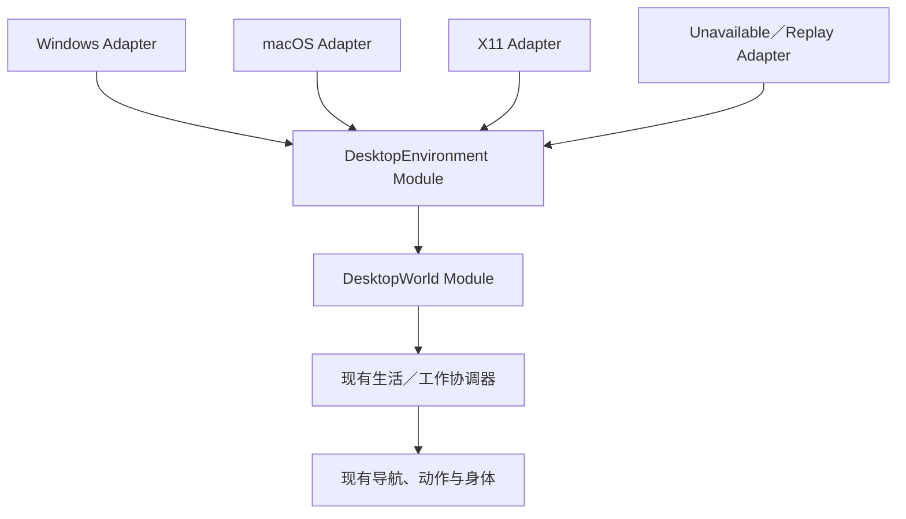

# 跨平台桌面互动与生活感优化方案

状态：2026-10-22 待实施方案。本次授权为建立方案、评估现有路线与三平台兼容性；不包含行为实施、原生权限申请、安装、推送或发布。源码核对基线为 `a45a61e35415ac502cc8fdd0b5491fffdf76d65c`，最近行为提交为 `2737a3e`。当前执行范围只看[开发状态](../aliveness-development.md)。

## 1. 路线选择

建议在现有生活感路线中增加“空间身体补强与真实桌面互动”专项。本页独立维护方案细节，实施仍使用同一分支、同一产品入口、同一身体与协调器，不建立第二套桌宠产品。

| 选择 | 收益与代价 | 结论 |
|---|---|---|
| 独立原生桌宠／独立运行引擎 | 可以集中做单平台效果，但需重做角色、会话、存档、工作事实和身体交接；容易形成两个产品 | 不采用 |
| 直接在现有生活逻辑中追加 macOS 窗口调用 | 首个样例快，但平台条件、失败处理和坐标差异会进入动作策略，其他平台难以复用 | 不采用 |
| 共用行为与空间模块，原生环境由可替换 Adapter 提供 | 保留既有能力；平台差异集中到同一 Interface，三平台共用行为和回归场景 | 推荐，以下按此设计 |

macOS 专用 Adapter 本身不会使产品只能在 macOS 使用；风险在于把它当作生活循环的必需依赖，或者用本机通过代替其他平台验收。窗口感知是增强能力，基础空间与交互必须在没有窗口信息时仍成立。

本专项衔接[空间与身体复核](space-body-review.md)，补强第 1–3 期能力在默认产品中的装配，并复用第 4–5C 期。原第 6 期出门／关系痕迹、第 7 期自主跨屏仍为后续候选，不重编号，不把制作工作台验收扩成产品验收。

## 2. 当前兼容性事实

| 当前证据 | 能说明什么 | 不能据此声明什么 |
|---|---|---|
| [CI](../../.github/workflows/ci.yml) 配置 Windows、macOS、Ubuntu 的测试，以及三平台 × 四个 DSH 版本安装矩阵 | 已有跨平台工程与同包安装入口 | 本分支当前提交已经跑绿，或新桌面互动已有三平台结果 |
| [Linux 图形测试环境](../../.github/actions/setup-linux-display/action.yml) 使用 Xvfb＋Openbox | Linux CI 的实际图形会话是 X11 | 原生 Wayland、GNOME／KDE 实机、多屏或混合 DPI 已验收 |
| [键盘 Adapter](../../desktop/keyboard-activity.cjs) 有 macOS、Windows、X11 三条实现；Wayland／Xwayland 会话返回 unknown | 现有代码已按会话能力分流 | 所有 Linux 会话都能运行相同的自主循环；unknown 不等于 idle |
| [原生键盘检查](../../tests/keyboard-activity-native.mjs) 在 Windows 可记录 `usable:false` 而不因 unknown 失败 | 能检查协议与辅助进程清理 | 在交互式 Windows 桌面已取得可用输入信号 |
| [初始锁屏状态](../../desktop/lifecycle-state.cjs) 与[主进程](../../desktop/main.cjs) 对未知状态保守挂起；原生测试可显式控制初态 | 生命周期失败有保守处理 | 受控 unlocked 可以证明普通安装的真实初态可用 |
| [多屏契约](../multi-display-contract.md) 已区分全局 DIP 与窗口局部坐标 | 可复用坐标及显示修订规则 | 可以直接使用各系统返回的原始像素或仅乘 DPR |

因此，当前没有“代码已改成 macOS 独占”的证据，但稳定性和能力对等仍有验证缺口。本方案不把现有 Windows／Linux 的 unknown、skip 或受控事实包装成真实桌面可用。

## 3. 产品能力与平台承诺

### 3.1 共同体验

基础体验包括默认产品中的平面放置、多方向身体、可理解的生活目标、触摸／拖动回应、工作抢占与恢复、消息和存档。它们不要求读取其他应用窗口。

增强体验包括发现真实窗口的可见边缘、显式停靠、随承载窗口变化调整姿态、窗口消失后恢复，以及在可确认的全屏／工作区切换时暂停。它们按能力开启；关闭增强后保留基础体验与原有状态。

全局输入或生命周期未知仍按既有规则暂停需要这些许可的自主行为。关闭窗口增强不能解除这类暂停。角色缺方向或接触能力时走明确的角色回退，不用平台名伪装角色能力。

### 3.2 平台矩阵与 Wayland 决策

以下是交付目标及探针要求，全部新能力尚未实现。

| 环境 | 基础体验目标 | 真实窗口互动路线 | 交付要求 |
|---|---|---|---|
| Windows 交互桌面 | 共同体验完整回归 | Win32 枚举／事件、可见边界与 DPI 归一化 | 真窗口、真实输入枚举和同包安装；远程／服务会话单列 |
| macOS 交互桌面 | 共同体验完整回归 | CoreGraphics 窗口几何；按需要评估 AppKit／AX 事件 | 验证普通安装权限、Space、全屏与坐标；不使用私有窗口管理接口 |
| Linux X11 | 共同体验完整回归 | X11／EWMH 窗口、堆叠、装饰边界和事件 | Xvfb＋窗口管理器自动化，加实际桌面验证；缺协议返回 unavailable |
| Linux 原生 Wayland | 同一核心与数据兼容；桌面自由定位、全局输入和覆盖层体验需探针确定 | 通用 Electron 路径无法假定全局坐标与完整窗口几何；合成器扩展为单独候选 | 不标注为 X11 等效；GNOME／KDE 分别记录。基础显示／操作若未成立，明确列为未通过 |
| Wayland 中的 Xwayland | 不能因存在 DISPLAY 就判为纯 X11 | 必须核对 native Wayland 窗口是否可见；部分枚举不能用于全桌面避让 | 不自动强制切换后端，不以只看见 X11 子集证明完整桌面支持 |

建议保留三平台产品目标，并将 Linux 会话类型列入支持与验收表。Windows、macOS、Linux X11 是本轮完整窗口互动的共同交付门槛；Wayland 的受限体验或完整扩展方案必须单独评审，不能悄悄把 Linux 的对外承诺改成仅 X11。

若产品要求原生 GNOME／KDE Wayland 也具备相同的全桌面停靠与避让效果，则在 D0 后增加合成器集成工作包，并将该要求纳入发布阻断条件。普通应用窗口内的角色展示可作为待验证的替代体验，但它不等于全桌面伴侣，不能用它宣布功能对等。没有跨合成器验证时不承诺“任意 Linux 桌面均同等支持”。

Electron 官方说明原生 Wayland 上全局窗口定位、全局光标查询等能力受限；此限制也会影响覆盖层和拖放，不能只关闭窗口枚举就假定其他功能正常。[Electron Wayland 说明](https://www.electronjs.org/blog/tech-talk-wayland)

## 4. 模块与 Interface 草案

以下名称用于表达设计，尚不是公开协议或已存在文件。内部实现按既有 JS／CJS 与 TypeScript 工具链落地，不引入第二个 UI 引擎。

- **DesktopEnvironment Module**：在原生主进程管理 Adapter、能力、快照、超时和清理。Interface 只暴露启停／订阅当前状态／释放，以及版本化快照；OS 句柄、系统调用和重连策略留在 Implementation 内。Replay Adapter 与原生 Adapter 经过相同 Interface，不在 Renderer 伪造生产感知。
- **DesktopWorld Module**：纯几何与资格判断。将规范化快照转为可见边缘、停靠候选和避让区域；不修改系统窗口，不直接驱动身体。工作台、产品和测试使用同一 Module。
- **既有协调器**：决定哪些候选成为生活意图，处理用户／工作占用和中断。保留一套身体拥有权、一条动作时间线。环境采样有独立采样周期，但不能另启身体调度器。
- **现有事实与存档**：工作事实仍来自 WorkSources，完成仍复用 `src/completion.ts`。窗口关闭、应用切换、模型接受回执均不是工作完成，也不自动成为相处记忆。

### 4.1 快照语义

| 字段组 | 必须表达的含义 |
|---|---|
| 能力 | 分别声明桌面定位、全局光标、窗口几何、堆叠／遮挡、工作区、全屏可用性；不使用单一 `supported:true` |
| 可用状态 | disabled／starting／available／unsupported／denied／stale／failed；能力可在运行期撤销 |
| 身份与时序 | Adapter epoch、序号、几何 revision、采集范围和主进程单调时钟的新鲜度；跨进程时钟不直接相减 |
| 几何 | 使用既有显示器 ID 和全局 DIP，声明有效覆盖范围；原始系统单位在 Adapter 内转换，Renderer 再按实际 contentBounds 换算 |
| 窗口 | 主进程生成的临时对象身份、外边界、可确认的顺序与可见状态；重启不恢复旧 OS 窗口绑定 |
| 完整性 | 成功的空列表与采集失败明确区分；partial 不能作为全桌面无障碍／无遮挡的证据 |

原生句柄复用须结合来源代次与对象生命期识别。丢弃旧代次／旧序号数据；显示布局改变使旧路径和附着失效。容量、采样频率和过期时间在 D0 按测量确定并写入实现契约；超容量不得静默截断后报告完整。传给角色 frame 的只应是必要动作和局部目标，不开放系统枚举 Interface。

默认只需要临时几何和有限状态，不采集标题、窗口正文、截图、剪贴板或按键内容，不持久化应用使用历史。若之后需要应用类别响应或 AX 权限，另列用途、最小字段和拒绝后的行为，不作为本专项隐含依赖。

### 4.2 三类原生 Adapter

| Adapter | 候选实现与必须解决的问题 |
|---|---|
| Windows | `EnumWindows` 与可见性／最小化筛选，`SetWinEventHook` 变化提示加快照核对。可见外框采用适当 DWM 数据；区分 DPI 虚拟化、不可见缩放边框、隐藏／cloaked 和不同桌面。实际排序须由双窗口遮挡用例证明 |
| macOS | `CGWindowListCopyWindowInfo` 获取有限几何和前后关系，排除自身窗口；事件提示与有界采样结合。Space、全屏、Dock、权限撤销及辅助进程超时分别验证，不从窗口尺寸单独断言所有全屏状态 |
| Linux X11 | 先查询 `_NET_SUPPORTED`，用 `_NET_CLIENT_LIST_STACKING`、`_NET_FRAME_EXTENTS` 与窗口事件生成快照；处理重设父窗口、桌面切换、面板区域和管理器退出。EWMH 从底到顶的顺序归一为共享顺序 |

Windows 可见边界与 `GetWindowRect` 的 DPI／边框含义不同，必须实测转换；X11 属性取决于窗口管理器实际支持。[Windows 几何说明](https://learn.microsoft.com/en-us/windows/win32/api/winuser/nf-winuser-getwindowrect)、[WinEvent](https://learn.microsoft.com/en-us/windows/win32/api/winuser/nf-winuser-setwineventhook)、[EWMH](https://specifications.freedesktop.org/wm/latest-single/)

辅助进程必须有超时、有限重试、父进程退出清理和暂停策略；窗口采样失败不能阻塞输入／渲染。采用原生二进制时按平台与架构分别构建，并进入同一规范分发包；不能把本机产物当作 Windows／Linux 依赖。最终依赖与打包方式由 D0 验证后选择。

## 5. 空间规则与交互闭环

### 5.1 基础平面与窗口停靠

平面位置 `(x, y)`、离地高度、身体朝向与注视目标分别表达。普通拖放停在合法平面位置；窗口附着由显式设置或清楚的吸附提示进入，不让几何探测偷偷改变普通拖放语义。

窗口外框是互动候选与避让参考，不把所有应用矩形一律变成不可穿越的地面实体；基础平面、已确认的硬禁区、内容避让与窗口支撑边分别建模。缺少内容识别时不声称知道编辑光标、正文或用户正在阅读的具体区域。

附着记录“对象身份＋支撑边＋沿边偏移”，可见边缘按遮挡裁剪，再扣除身体和持物的占用宽度。窗口移动时跟随支撑变换；急速移动、缩小或越屏时优先安全退出，不无限追赶。窗口关闭／最小化／不可确认可见时撤销支撑，从实际姿态退出；新几何未知时停在当前合法平面位置，只有已知可达时才返回停靠点。

边缘可见性与角色像素遮挡是不同问题。第一版只支持可见外边缘互动，不承诺任意角色部位能正确插入其他系统窗口之间；圆角、透明窗口和特殊层级采用保守候选过滤。

### 5.2 两个可操作切片

| 切片 | 必须看见的结果 |
|---|---|
| 基础生活 | 中上部放置停稳 → 真实正面／斜面关注用户 → 前往明确目标 → 用户触摸／工作抢占 → 从实际进度恢复 → 返回停靠点；窗口增强关闭时也成立 |
| 真实桌面 | 显式放到真实窗口边 → 身体稳坐／站立 → 用户移动／缩放窗口 → 姿态连续调整 → 遮挡／关闭窗口 → 解除附着并恢复；三平台使用同一交互规则 |

先制作正背面／斜向站立、行走、转身及所需停靠姿态；以运行中的接触与比例确认资源。坐姿、拿放、表情仍受已有身体拥有权约束。旧角色继续按能力回退，旧配置迁移不得覆盖用户显式设置。

## 6. 实施顺序与退出门槛

以下 D0–D4 是同一专项的工作包，不是新的阶段编号；当前全部未实施。

| 工作包 | 具体交付 | 进入下一步的证据 |
|---|---|---|
| D0 平台能力探针 | Windows／macOS／X11 使用同一双窗口场景，记录枚举、移动、缩放、遮挡、关闭、坐标、输入与生命周期；另测原生 Wayland 的定位、穿透与数据范围。冻结字段、TTL、资源预算、依赖和平台承诺 | 三个平台至少取得真实样本；未知状态有原因。Wayland 是否需合成器扩展形成明确决策；缺设备是未验证，不能用 macOS 代签 |
| D1 默认空间与身体 | 平面位置／高度分离，多方向最小资源，拖放、阴影、命中、气泡一致；保留旧角色及设置迁移 | 基础生活切片在默认产品成立；三平台受控回归和原生证据分别记录；原生 Wayland 若无法桌面定位，明确其未通过范围 |
| D2 共享环境与几何 | DesktopEnvironment／DesktopWorld、Replay／Unavailable Adapter；事件时间线与几何调试视图；安全失效与恢复 | 同一录制输入产生相同候选和状态；旧数据、partial、拒绝、超时、辅助进程崩溃不能产生假支撑或影响聊天 |
| D3 三平台真实窗口切片 | 三个原生 Adapter 接同一 Interface；默认产品支持显式窗口附着、变化与退出；增强默认关闭，用户显式开启 | Windows／macOS／X11 同一切片分别验收，能力缺失回退通过；不能以单平台演示宣布专项交付 |
| D4 节奏、回归与交付 | 在既有人格评分上加入适度新鲜感／切换成本，打磨身体预备与收势；完成三平台同包安装、资源与使用说明 | 同场景对照证明可读意图与低打扰；跨平台工程门槛、系统实机和用户 LIVE 感各自结算 |

D0 的部分探针与 D1 美术样片可独立推进，但不能先完成 macOS 全链路后无限延期其他 Adapter。D0 任一目标环境无法建立可靠几何时，先调整承诺／实现，不把 OS 判断散入行为模块。D1 可以独立交付价值；D3 未完成不阻塞已验收基础能力，但增强不能因此默认开启或宣传为三平台等效。

工期在 D0 的平台样本与 D1 的方向样片通过后估算。主要不确定性是多方向素材工作量、系统会话差异、原生依赖打包和实机资源，不用乐观天数代替这些门槛。

## 7. 验证与防止平台退化

| 层次 | 必做验证 | 结算方式 |
|---|---|---|
| 纯逻辑 | 多屏负坐标、DPI、遮挡分段、空／partial 快照、旧代次、句柄复用、目标取消、附着恢复 | 全平台同一 Interface 与回放夹具 |
| 浏览器 | 默认主页面的基础切片与窗口切片，拖动／工作／阅读抢占，缺能力与热切 | 包含 `test:inbox-ui`；输入受控与真实 WebGL／导航分别说明 |
| 原生自动化 | 测试拥有的两个独立顶层窗口，经 OS Adapter 真实枚举／变化；坐标、穿透、焦点和清理 | 操作串行、隔离 profile；不能直接把测试窗口坐标注入 Adapter 伪装原生成功 |
| 平台会话实机 | Windows 控制台、macOS、实际 Linux X11；Wayland 按合成器／版本独列；物理输入、全屏、锁屏、多屏 | CI runner／Xvfb 结果与物理桌面结果分开；缺失列为未验证 |
| 分发 | 保留当前三平台 × 四宿主同包安装及发布工作流；新增辅助文件核对来源、架构和摘要 | 同一提交、版本、规范包摘要；不要求用户临时安装开发工具才能日用 |
| 体验与资源 | 同输入、尺寸、种子进行基础／增强开关对照；记录意图识别、恢复、重复、打扰与资源 | 先短时试玩再真实办公观察；用户观感与自动化不互相代替 |

具体防退化要求：

1. 目标交互桌面上的 `available`、可用输入样本和真实几何必须是正向断言。unsupported／unknown／skip 只证明回退，不能算增强通过；修正当前 Windows 检查仅协议通过的证据缺口。
2. 生命周期必须有普通安装真实初态检查；测试覆盖值只验证状态机。采样辅助进程异常不改变工作完成、会话请求或用户配置。
3. 基础生活不得被窗口增强的 unavailable 总开关冻结。全局输入／锁屏未知导致的保守暂停必须保留，并在诊断中区分原因。
4. 主进程按明确能力分流；通用生活、人格、导航与动作模块不得出现 `darwin`／`win32` 行为分支。三平台可用快照归一后消费同一策略。
5. 新增最低系统版本、原生依赖或权限必须进入支持表和同包安装；当前方案不自动提高最低版本或降低已有支持范围。
6. 如果原生 Wayland 功能对等被确定为发布要求，其缺口必须阻断该承诺的发布，不能用 X11 绿色结果抵消。

## 8. 参考项目的采用方式

以下为 2026-10-22 文档与部分源码调研；未在本机安装这些项目。参考经验不代表依赖已选定，也不代表素材可直接复用。

| 参考 | 采用内容 | 保留的判断 |
|---|---|---|
| [Desktop Mate](https://store.steampowered.com/app/3301060/Desktop_Mate/) | 窗口停靠、鼠标反馈的产品表现 | 用于体验对照，不承担跨平台适配证明 |
| [eSheep](https://github.com/Adrianotiger/desktopPet) 与 [macOS 移植](https://github.com/iappyx/DesktopPetMac) | 窗口身份、承载边、窗口消失和状态动作经验 | 原项目积累与较新移植的验证范围分开 |
| [TypePet 几何](https://github.com/Leonana69/TypePet/blob/8fb9ce4d50f5132e3ff614259b077a272e38282f/Engine/WorldModel.cs) | 窗口矩形转为可见边缘的纯转换 | 研究算法，保留我们平面放置、工作与存档语义；不整包移植 |
| [Hammerspoon 窗口过滤](https://www.hammerspoon.org/docs/hs.window.filter.html) | 窗口事件整理与会话状态处理 | macOS 参考；该模块文档有实验性提示，不作为必装运行依赖 |
| [Apple 窗口信息](https://developer.apple.com/documentation/coregraphics/quartz-window-services) 与 [Windows 枚举](https://learn.microsoft.com/en-us/windows/win32/api/winuser/nf-winuser-enumwindows) | 平台 Adapter 的官方能力依据 | 具体权限、会话及数据完整性由 D0 实测 |

后续授权实施时，从 D0 与 D1 的具体范围进入；形成的正式 Interface、配置迁移和行为规则更新到对应现行契约。本页继续维护路线与选择依据，不替代现行产品行为说明。
