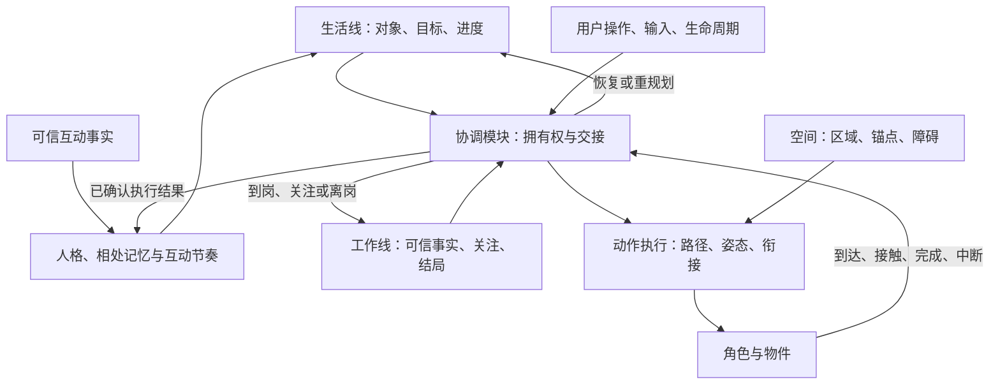

# 生活感实施方案：先建立能生活的空间与身体

> 状态：后续阶段蓝图。第 1–2 期已交付，第 2 期与花箱绕路修正已获用户验收；第 3 期尚待用户确定。当前进度与执行授权只看[开发入口](../aliveness-development.md)。下文描述完整演进目标，规划参数和接口不自动成为当前契约。
>
> 体验来源：[已归档的概念稿 v0.1](../archive/2026-10-aliveness/aliveness-concept-v0.1.md)。最初源码核对基线：`7d55786d096552dea62ef974237d942ab03c3b2f`，`package.json` 版本 0.4.13（2026-10-19）；不代表发布状态。
>
> 当前路线采用：**新美术与空间划分 → 二维运动 → 动作连续性 → 生活／工作双线协调 → 丰富行为**。历史概念和排序仅供追溯；当前分支成果见[开发状态](../aliveness-development.md)，已发布行为仍以[文档索引](../README.md)内契约为准。
>
> 上游人格、记忆与互动节奏的候选取舍维护在第 7 节。清醒坐姿与走路摆臂已另行移植并完成工程回归，见[开发状态](../aliveness-development.md)；该交付不包含第 3 期或人格／模型接入。

素材按[需求池](aliveness-art-assets.md)按需选取；已有角色和 SVG 优先复用，只补实际画面验证出的缺口。当前坐标、地面／立面与完整禁区模型见[空间契约](living-space-contract.md)。

## 1. 调整依据

先把已有动作串成日常，容易验证到“脚本能播放”，却无法判断角色是否真的在空间里生活。空间决定能去哪里，身体决定如何移动与操作，衔接决定行为是否可信；这些是生活逻辑的验证基础。

首个目标改为：**在一张有家、有工作岗位、有障碍的小地图里，复用已通过角色并按需补充美术，完成真实二维移动、自然停转和跨行为衔接。**

美术与运动交替验证：先完成覆盖一个完整故事的视觉样板与可绑定素材，再随运动和衔接补齐。新增运动方式先验证小样，再展开对应动作、人格和道具。

敏捷交付仍以可见成果为单位：空间样板、可操作运动场、连续行为、双线交接，每期都能看见进展，不只以台词和动作数量衡量。

## 2. 接续规划的基础

已交付能力与验证边界集中在[开发状态](../aliveness-development.md)。现有样板可复用二维运动、地面／完整禁区模型、真实回执与旧 API 2 回退；O03 连续拿放仍在独立水平平面。

下一候选为第 3 期“连续动作与物件”：从当前位置走近、站稳、转身、接触与退出，并在指定姿态和接触前后打断后续接。它需要用户确定执行范围后再形成阶段契约，不能由下文蓝图自动开工。

完整生活／工作协调在第 4 期候选。第 5 期在人格影响真实行为、有限相处记忆与互动节奏之间拆小交付，第 6 期再扩缺席与关系痕迹。出门、存档扩展与跨屏仍按后续阶段逐项选择，不成为第 3 期隐含依赖。

## 3. 生活与工作是两条意图线，共用一个身体

**生活线**关心自己的目标：整理、休息、探索、出门和读留言。保留对象、目标、步骤与进度；工作打断后不自动遗忘，也不无条件重播。

**工作线**消费可信 Harness 事实：工作开始、生成、工具活动、审批、提问、异常、普通回复与目标完成。它关心关注什么、岗位需求和结局，不借生活台词解释任务内容。

**协调模块**决定身体运动、物体操作、视线、表情与社交通道的拥有权，不替两条线生成目标。两条线都可保留状态，但不能同时控制身体位移。

两条线共享呼吸、转向、起身和移动等身体能力，使用各自的动作组合、对象与语义。整理贝壳、守信封、等待审批不能都成为同一个 `look → nod → sit`。

这是对概念稿“单一议程”的实现调整：生活自治仍只有一个议程；工作事实独立驱动工作线；两者经过唯一协调和执行入口，不并行两套随机漫游或身体调度。落地前写明契约差异。

### 首个完整故事

她在小窝前整理贝壳 → 收到工作事实 → 视线先转向岗位 → 放下贝壳 → 起身转向 → 沿合法二维路径移动 → 减速到位并进入守候姿态 → 真正完成后确认、释放情绪 → 回望贝壳 → 判断原目标仍有效 → 返回接着整理。

同一个故事检验美术、空间、运动、物体接触、衔接、事实语义和恢复。不能用预录动画、计时假到达或外层 CSS 移动替代执行。

第 5 期继续在这个故事中观察人格与记忆：安静或活泼的角色怎样选择停留、探索和招呼；一次确实完成的共同活动怎样影响下次回应。生活目标与动作事实保持可核对，不靠不同台词宣称性格不同，也不把未完成的整理写成共同经历。

### 交接规则

- 生命周期挂起和用户拖动先控制身体安全。用户拖动取消旧路线，生活目标按新位置重新判断。
- 工作／审批事实与必要通知及时呈现，不等角色走到岗位。逻辑响应与物理抵达分别验收。
- 普通任务可先转头、放下物件再移动。动作标注可中断点与有界交接时长；审批／错误可快速交接，不能无限等待播完。
- 紧急安全停止可直接取消运动；平滑不能以穿越禁区、错误操作物件或阻塞提醒为代价。
- 长任务时保留生活意图，可在岗位换姿和有限观察；未决请求期间不擅自远游。工作状态也不是永久站住不动。
- 工作解除后检查原对象与目标是否仍有效，再续接、重规划或结束，不必每次回家从头演。

## 4. 空间与新美术共同定义

首版采用单屏二维坐标；“二维可移动”不要求先做八方向角色或完整 3D 场景。朝向、移动姿态和遮挡方案在样板中验证。

| 区域／对象 | 用途 | 规则 |
|---|---|---|
| 家与生活区 | 整理、休息、留物件 | 有交互锚点、靠近方向和操作范围 |
| 工作岗位 | 守候、看信封、响应任务 | 语义区别于生活区；在工作内容区域外 |
| 门槛与连接路径 | 两条线间移动、停看、交接 | 可真实通行，考虑身体尺寸和转向余量 |
| 空地与栖木 | 探索、停留、后续高低差 | 只启用运动能力已支持的地形 |
| 禁区与面板占区 | Harness 内容、手动禁区、本产品面板 | 按实体地面占用／完整内容禁区模型检查全路径，不能只检查终点 |
| 出入口与痕迹区 | 后续出门、牌子、归来 | 预留位置，首个样板不实现旅行系统 |

地图分别表达可占据区域、连接路线、交互对象与锚点、遮挡层级。栖木不能只画成装饰便假定可达；门槛必须实际参与运动约束。

工作区先采用明确标记的手动矩形。自动来源仅允许验证过的 Harness 自身公开几何与状态；不可用则说明为手动模式，不枚举其他应用、不读标题、不截屏识别。真实系统全屏应用兼容单独核验。

后续美术需求保留大肥鱼识别特征，按完整故事与运行画面选择性补充；以下是需求维度，不要求全部重制：

1. 空间构图：家、岗位、路径、门槛、贝壳和信封的尺寸／层级关系。
2. 角色分层与绑定规格：躯干、头、视线、鳍／手、尾部、头发、衣物；重心、地面／悬浮锚点、接触点与变形范围。
3. 连续运动素材：静候、移动预备、移动、转向、减速、停稳。复用已验收步态；新增走／游／滑行风格时先验证小样，再制作对应姿态。
4. 两组有语义的操作：生活侧拿起／整理／放下，工作侧关注／到岗／守候；以及起身、回望、收心等交接动作。
5. 表情与身体分层：支持移动中看向任务、放下物件时保持关注，不只提供互斥整段动作。

概念图用于视觉判断；素材需分层、绑定并在目标渲染器验证后，才算运行资产。先完成一套可用素材，再扩人格、换装和大量场景。

## 5. 敏捷顺序与可见交付

| 阶段 | 本期交付 | 直接看到什么 | 下一期门槛 |
|---|---|---|---|
| 1 美术与空间样板 | 视觉样板、最小分层素材、单屏分区、身体／对象锚点规格 | 可摆放角色物件、显隐分区的空间预览 | 生活区／岗位可区分，尺寸合理，首条路线可行 |
| 2 二维运动场 | body 内 x/y 运动、路径、转向、制动、真实回执与命中 | 点合法目标，绕障移动停稳，可拖动打断 | 绘制／命中／气泡一致，隔离原生单屏可用 |
| 3 连续动作与物件 | 进入／退出、姿态延续、接触锚点、可中断点 | 起身、转身、走近、拿放自然衔接，打断后续接 | 指定打断时刻无瞬移、穿物或重复操作 |
| 4 生活／工作双线 | 独立意图、唯一协调、可信事实驱动交接 | 整理贝壳 → 上岗 → 忙完接着整理 | 回复／推进／完成／未决请求语义正确，交接自然 |
| 5 生活选择、人格与相处 | 先稳定人格影响行为，再有限记忆，最后合批回应与安静节奏 | 同空间和任务下有可辨认的生活偏好；记得确实发生的互动，知道何时回应 | 选择理由可追溯；同一事实只结算一次；人格不突破工作与邀请边界 |
| 6 缺席与关系痕迹 | 基于有限记忆扩展出门、牌子、召回、留言与归来 | 她离开后仍可留言，回来读信，任务可召回 | 通知可靠，重启／写失败清楚，留言不刷成长，不补演离线经历 |
| 7 桌面适配与扩展 | 自动几何能力、地图编辑、更多地形、跨屏与回退 | 工作区变化引起让位，编辑地图，从边缘跨屏 | 平台／宿主与物理多屏分别验证 |

第 6 期按出门召回、留言归来拆小故事；第 7 期按动态空间、地图、跨屏分别交付，不合成一个大版本。

第 5 期按第 7 节的人格、记忆、互动节奏三个小交付顺序推进；每项通过自己的可见验收后再扩下一项，不一次引入整套模型人格或六种人设。

前四期在同一小地图、同一个完整故事上逐步加深，不每期更换舞台。第 2 期就验证隔离原生单屏，不能等浏览器全做完才发现窗口、坐标或命中不可用。

不沿用上一版基于旧素材复用的工期估算。前两期已有可运行样板与协议基础；后续工期按连续动作、接触和中断场景重新评估。

## 6. 运行时：行为驱动连续状态

上层描述到哪、看哪、做什么、允许怎样打断；执行模块从当前身体状态完成它，减少上层定时发动作词串。

- **world**：空间有效性、对象锚点、合法路线与几何修订。
- **life**：生活目标、进度及保留／放弃／重选的理由。
- **人格、记忆与节奏**：给生活线提供稳定偏好、已确认经历与回应资格；不另起自动调度，不直接操作身体。
- **work**：公开事实、关注目标、岗位需求与结局，不解析正文。
- **协调模块**：唯一身体拥有权、通道叠加、交接和取消。
- **motion／action**：位置、速度、朝向、姿态、物件接触、进入／循环／退出与真实回执。
- **figure**：把连续姿态和表情绘制出来，不自行选择生活／工作目标。

外部 Interface 保持紧凑：纯策略接收时钟、种子、事实、几何、人格配置、有限记忆摘要和身份回执，输出目标／交接请求；body 执行并回报。记忆写入只消费可信事件与执行结果，不由 figure 自报或根据动作耗时推断。现有可选二维协议见[角色接口](../characters.md)；后续动作与协调扩展按实际阶段形成契约。

动作连续性的要求：

1. 保存当前 x/y、速度、朝向与运动相位，换目标从当前状态重规划，停止后不从另一处继续。
2. 操作定义前提、进入姿态、接触／提交时刻、结束姿态、退出路径与中断点；暂停不能只保存“播到第几秒”。
3. 表情、视线、姿态、位移分层叠加，服从身体／物件接触约束。只做两个不兼容姿态的 crossfade 不等于连续。
4. 拿放结果由真实接触与幂等提交决定；提交前后中断须得到正确恢复行为。
5. 布局、点击区域、阴影、气泡使用同一坐标结果，不另维护外层视觉运动轨道。
6. 回执绑定角色代次、操作身份和几何修订，旧对象／角色／路线回执不推进当前目标。

现有 kit 实现先评估再复用；二维能力如需修改固定上游，则明确维护补丁、能力协商和来源说明。旧 API 2 角色保持底边兼容模式，不以 CSS 平移冒充二维支持。新逻辑不能假定所有角色都能拿物、转身或上栖木。

## 7. 上游借鉴：人格、记忆与互动节奏

依据 [2026-10-19 固定调研](../archive/2026-10-aliveness/upstream-motion/README.md#固定调研)：Coopanion 固定提交为 `07dfa744696f0c63292a7af1b7dfc25a09c87cc2`，其 Cortico 子模块为 `087289dfcdf262a771c573d16dbaf2392ce6764b`。以下为本地设计取舍；人格、记忆和互动节奏仍为候选方案，已移植的表现补丁单独标注。

### 7.1 复用、适配与自研边界

这里的“复用”指已有本地能力；“择取”指从固定上游提取代码或文案、适配后验证；“借鉴”只复用方法，由本地实现机制。

| 内容 | 可以复用什么 | 需要本地实现或适配什么 |
|---|---|---|
| 人格与自述 | 借鉴上游人设种子、允许沉默、保留用户改动的设计；可按角色改写种子文案和择取出厂版本识别方法 | 将稳定人格映射到真实的探索偏好、停留时长和表达选择；配置版本、切换与回退。上游自述主要是模型提示词，没有这套身体行为映射 |
| 用户画像与相处细节 | 借鉴 `PARTNER.md` 精炼画像与 `partner/` 事件细节分层的方法 | 可信事实准入、有限摘要、查询／纠正／删除、过期与存档迁移。`core/persona.ts` 依赖 Cormini 的模型前缀和文件工具，不能直接作为我们的存档服务 |
| 身体反应与稍后回应 | 复用现有 API 2 动作、可信抚摸识别与关系结算；借鉴上游反射先发生、触摸合批后交流的时序 | 本地互动事件合并、回应候选与失效规则。上游 `world.ts` 的触摸队列绑定模型唤醒，需要提炼逻辑，不能把模型事件总线一并接入 |
| 主动、静默与退避 | 复用现有 off／quiet／interactive、邀请预算、稍后与今天安静；借鉴 `pet_quiet` 临时覆盖与心跳退避思路 | 在同一生活调度内实现有界回应节奏、占用后的重新评估、过期丢弃。上游模型心跳默认关闭，其闹钟允许重启补送；我们的日常不接该唤醒器，也不补播离线互动 |
| 记忆版本与写入 | 复用本地 `CompanionStore` 的可信所有者、修订、单写、幂等和原子写机制；借鉴上游修改可追溯与不覆盖已改人设 | 扩展有界记忆 schema、迁移和必要的纠正记录。上游逐次 Git 提交的工作区历史不作为产品存档依赖，本地另定条目与容量上限 |
| 表情与身体表现 | 复用已引入的 rig、动作词表、嘴部和表情能力；清醒坐姿与走路摆臂已移植并完成工程回归，眉毛增强仍为候选 | 后续表现补丁继续保留任务脸、手部、持物姿势及二维协议的优先权，分别验证。表现补丁不是人格系统本身 |
| 生活／工作交接与物件 | 复用本地二维导航、O03 接触样板、可信工作事实与真实回执；参考上游 walk 的取消回执 | 自研唯一身体协调、连续姿态、物件所有权、接触提交及中断恢复。模型的 handoff 笔记不能恢复真实手部／物件状态；窗口攀爬 PR 也不能替代此闭环 |

上游源码入口：[人设与覆盖保护](https://github.com/Pal-AI-Lab/Coopanion/blob/07dfa744696f0c63292a7af1b7dfc25a09c87cc2/core/seed.ts)、[人物画像与历史](https://github.com/Pal-AI-Lab/Coopanion/blob/07dfa744696f0c63292a7af1b7dfc25a09c87cc2/core/persona.ts)、[互动与临时安静](https://github.com/Pal-AI-Lab/Coopanion/blob/07dfa744696f0c63292a7af1b7dfc25a09c87cc2/packages/cortico-world-desktop-pet/src/world.ts)、[固定版本心跳](https://github.com/Pal-AI-Lab/Cortico/blob/087289dfcdf262a771c573d16dbaf2392ce6764b/bots/cormini/persona/heartbeat.ts)。实际移植代码或文案时固定提交、保留署名，并更新上游改动记录；这些候选不要求整体升级导入基线。

### 7.2 人格影响选择，情绪保留当下

人格是稳定偏好，情绪是已有精力、兴致与当前事件形成的短时状态。用户的设置和安静选择始终优先；熟悉程度只影响已允许的招呼与表达，不增加通知、邀请或成长预算。

第 5 期先用“安静／活泼”两组候选在同地图、同输入和同随机种子下对照：人格需影响探索与停留的选择、可用动作中的表达方式和是否回应；具体参数范围在该小交付中标定。工作脸、审批／错误的语义、路径安全、固定尺寸与减少动态不随人格变化。

先复用一套身体与素材。人格描述与有界行为参数由同一版本配置关联，避免文案说安静而调度仍频繁打扰。切换、更新及回退从当前姿态和有效目标重新评估，保留用户修改，不重播旧动作。首批人格由显式选择确定，不因点击次数自动漂移，也不引入模型自行改写；额外人格与自改人格另行选范围。

### 7.3 记忆保留经历，执行进度服从真实状态

| 内容 | 来源、用途与保留方式 |
|---|---|
| 用户偏好与人物摘要 | 初版只来自显式设置或确认，例如喜欢安静、选定的互动方式；全 profile 共用的偏好不能因换角色丢失。不自动读取聊天正文、工作内容或推断用户画像 |
| 相处事件与关系摘要 | 初版记录可信确认的抚摸与完成的一起活动，按角色 id 隔离；摘要关联来源身份，细节有数量／大小／保留期上限。记忆、回应与关系成长分别结算，同一事实只能记一次、成长仍按既有准入和冷却 |
| 当前生活目标与执行进度 | 对象、步骤、姿态、接触是否提交及中断原因，用于运行期交接；它不是人物记忆。重启不凭故事或旧回执恢复握持、位置与动作，只恢复允许的存档摘要并重新核对场景 |

沿用 [自主陪伴契约](../companionship-contract.md) 的可信存档所有者和客户端代次隔离，后续扩展 `src/companion-store.ts`，不开放角色包写入。新记录应包含事件身份、角色、来源与实际结果；事件时刻由可信所有者校验。物件经历在第 3–4 期具备真实接触／完成回执之后才扩入，取消、超时或仅发起不写成成功经历。

记忆需可查看、纠正和删除；删除后不从旧摘要、缓存或迟到回执重新生成。仅在明确变更时写入，避免逐帧记日志；缺席不补成长，拒绝邀请不扣关系。未来 schema、损坏、无写权限和修订冲突沿现有规则降级，不覆盖原字节，也不显示未经落盘确认的新增经历。阶段实施前确定数据上限、迁移和删除语义，不在本蓝图提前定 schema 号。

### 7.4 互动节奏：当场反应、合批理解、择机表达

计划中的事件流程为：**真实输入 → 身体即时反馈 → 可信互动准入 → 同类事实合并 → 判断是否适合表达 → 经生活线与协调模块执行或安静结束**。

即时反馈沿现有交互发生；稍后回应知道哪些反射已经做过，不再次重演，也不再次记成长。待表达事实保留来源身份、发生时刻、已反应状态和失效条件；短时同类事件可以合并，连续抚摸不拆成多条邀请。合并窗口、最大数量与有效期在该小交付中确定，上游 2.5 秒窗口不直接成为本地契约。

表达候选只从新确认的互动、已允许的低频邀请或有效的生活交接产生；由已有单一调度评估，不添加另一套心跳、随机漫游或模型请求。安静结束是有效结果，不要求每个事件都生成台词或动作。quiet 模式仍不自动邀请，interactive 仍受现有预算与词表约束；人格和关系只能在这些限制内选择。

输入 active／unknown、阅读、草稿、发送、工作关注、拖拽、用户休息和生命周期占用继续优先。候选过期就丢弃；占用解除后检查当前事实与原目标，不积压、不补播、不因恢复或重启集中回应。沿用“稍后／今天安静／恢复”的权限和持久预算；若增加短时安静窗口，应独立记录到期与所有者，到期重评，不能写回并覆盖用户后来修改的全局设置。

第 6 期若加入归来、留言或稍后回看，先明确事件身份与有效期。应用关闭时没有发生的活动不编成经历；到期检查也不等于动作已完成。模型生成、自改人格和模型定时唤醒留作独立可选提案，需另定宿主能力、明确启用、数据范围与调用预算；本方案第 3–6 期的规则日常不以它们为依赖。

### 7.5 小交付与验收

| 顺序 | 可见交付 | 必须验证的场景 |
|---|---|---|
| 5A 人格影响行为 | 同场景下，安静／活泼在停留、探索或表达上有可辨认差异 | 同事实／种子对照，给出选择理由；忙碌、quiet、减少动态、缺词和缺移动能力时均守原限制；切换不重播 |
| 5B 有限相处记忆 | 能查看一次真实完成的互动，后续招呼可据此变化，也能纠正／删除 | 重复事件、迟到回执、换角色、跨重启、写失败、schema 迁移与删除后不复活；原关系计分不重复 |
| 5C 回应与安静节奏 | 连续抚摸先有即时反应，稍后至多形成一个有效回应；忙碌时安静，合适时再判断 | 验证即时反馈不重演、事件合并、过期丢弃、邀请预算、拒绝无惩罚、解除占用不集中补播；明确身体反射与真实互动仍各自准入 |

新增策略使用可控时钟、种子、可信事实和存档摘要测试；组合验收沿同地图完整故事观察。涉及 NPC 与界面行为包含 `test:inbox-ui`，新增存档执行修订／幂等／迁移验证；浏览器、受控原生、物理设备和用户观感分别结算。模型叙述不能代替本地事实与接触证据。

## 8. 验证“在生活”和“能播”分别结算

每期交付可运行场景、30–90 秒小剧场和一次现场改变条件的演示。脚本只复现输入，不替角色预定每步动作。至少改变一次障碍、目标位置、工作到来时刻或原生活对象，观察现场响应。

- 第 1 期：构图、可绑定性、尺寸、锚点和空间语义；概念图完成不代表运行时完成。
- 第 2 期：全路径与实体地面／完整禁区包络、转向／制动余量、真实抵达、障碍变化、拖动取消、几何更新和命中一致性。
- 第 3 期：坐姿、半转身、移动中、触物前后分别打断，检查姿态／位置／物件与接续结果；静态截图不能证明连续自然。
- 第 4 期：完成类别、重复事实、多会话关注、审批和异常抢占。工作线仍复用 `src/completion.ts`，发送接受回执不作为完成。
- 第 5 期：按第 7.5 节分别验收人格行为差异、有限记忆与互动节奏；规则日常保持无模型调用。
- 第 6 期：归来与留言只引用可信、仍有效的记录，核对关闭应用、时钟跳变和重启后不补演、不虚构、不重复结算。
- 时钟／随机／几何可注入；预览与隔离测试标记模拟事实，生产入口不可启用测试覆盖。
- NPC、聊天、收件箱、字号或多屏变更包含 `npm run test:inbox-ui`；保持正文 DOM、草稿、焦点／选区、发送身份与气泡时钟。
- 原生／安装用隔离 profile，桌面操作串行。自动矩阵、受控原生、真实设备与主观观感分别报告。

## 9. 契约与交付范围

已实现的编辑态、坐标、对象、锚点、遮挡、真实二维运动、地面／完整禁区、能力及回退集中在[生活空间契约](living-space-contract.md)。第 3–4 期形成《陪伴叙事契约》草案：双线、交接、可中断动作、完成分类与表现。每期只转正已实现并验证的条款。

主要契约变化是二维身体、空间设置、动作拥有权与双线协同。新素材按来源保留许可和归属；运行时变动同步角色接口和上游来源，不能只改概念图或业务策略。

继续保留：companionship 默认 off、roam 总许可、输入 unknown 安静降级、固定用户尺寸、减少动态替代、无读屏／读键内容／其他应用内容、无模型日常调用、单一 tick、空闲 30fps 上限与通知可靠性。

阶段枚举、拥有权和动作结果若进入诊断，同步 Renderer／main 严格校验、采样器及[诊断契约](../diagnostics-contract.md)，不记录具体坐标、目标身份、留言或聊天正文。资源结论绑定实际新包与有效采样，不能挪用旧报告。

后续新增持久字段由可信存档所有者管理，保留单写、修订、原子写、幂等、大小上限、迁移及损坏／未来 schema 只读规则。留言不计成长，不补离线剧情；具体限额在对应故事中确定，上一版数值不作为已确认要求。

第 5 期的稳定人格与有限记忆不授权模型接入或自由改写人格。远门、人格漂移、额外人格、角色包人格声明、相册与明信片在基础闭环之后逐项评估，不成为前四期依赖。

每期功能交付同步实现、测试、契约和使用说明；工程验证与用户观感分别结算。正式发布另按[发布流程](../releasing.md)执行同包验证。
