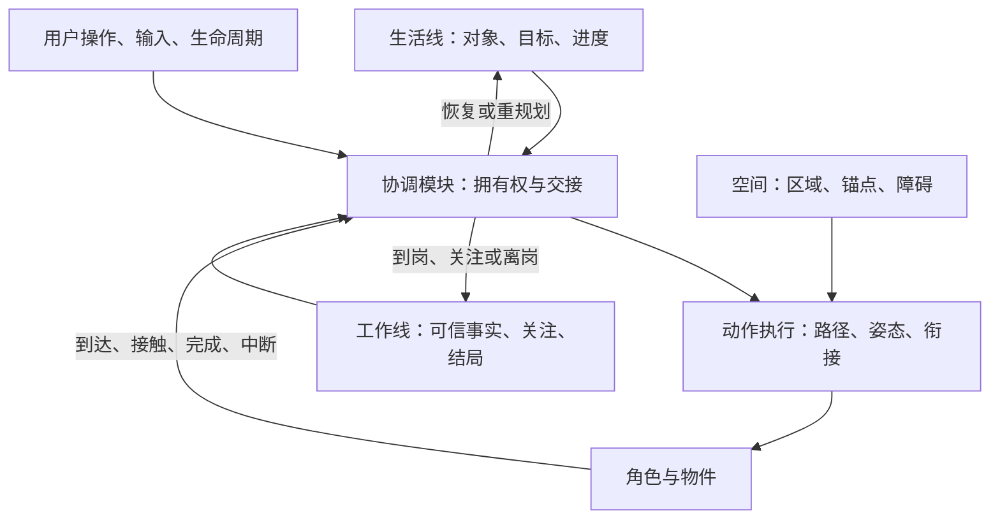

# 生活感实施方案：先建立能生活的空间与身体

> 状态：v0.3 分阶段路线；O03 资源与连续拿放探针已在隔离工作台验收，空间、二维运动与双线协调仍待实施。规划中的参数和接口不自动成为当前契约。
>
> 体验来源：[已归档的概念稿 v0.1](../archive/2026-10-aliveness/aliveness-concept-v0.1.md)。最初源码核对基线：`7d55786d096552dea62ef974237d942ab03c3b2f`，`package.json` 版本 0.4.13（2026-10-19）；不代表发布状态。
>
> 当前路线采用：**新美术与空间划分 → 二维运动 → 动作连续性 → 生活／工作双线协调 → 丰富行为**。历史概念和排序仅供追溯；当前分支成果见[开发状态](../aliveness-development.md)，已发布行为仍以[文档索引](../README.md)内契约为准。

美术准备按[当前资源表](aliveness-art-assets.md)执行：完整需求对照原概念稿，首批制作范围见其第 12 节。

## 当前阶段

| 范围 | 状态 |
|---|---|
| O03 贝壳、候选手图、锚点与动作工作流 | 指定主配色／尺寸的隔离浏览器探针已由用户验收；44 项动作与像素检查记录见当前工作台 |
| 第 1 期完整空间样板 | 待实施；已有 O03 不代表小窝、岗位、路径与新角色美术均完成 |
| 第 2 期二维运动场 | 待实施；当前真实移动仍是水平 `walk(x, run, id)` |
| 第 3 期完整衔接能力 | 完成轻物件子故事；坐站、独立肘膝、任意二维接触尚未验收 |
| 第 4–7 期 | 待实施／评审，按后续用户范围逐个故事推进 |

阶段状态以[当前开发入口](../aliveness-development.md)为准；下文为后续路线与验收目标。

## 1. 调整依据

先把已有动作串成日常，容易验证到“脚本能播放”，却无法判断角色是否真的在空间里生活。空间决定能去哪里，身体决定如何移动与操作，衔接决定行为是否可信；这些是生活逻辑的验证基础。

首个目标改为：**在一张有家、有工作岗位、有障碍的小地图里，使用一版新角色美术，完成真实二维移动、自然停转和跨行为衔接。**

美术与运动交替验证：先完成覆盖一个完整故事的视觉样板与可绑定素材，再随运动和衔接补齐。主运动方式尚未验证时，不一次制作全部动作、人格和道具。

敏捷交付仍以可见成果为单位：空间样板、可操作运动场、连续行为、双线交接，每期都能看见进展，不只以台词和动作数量衡量。

## 2. 当前基础与真实缺口

| 已核对的基础 | 可复用 | 需新增或重设计 |
|---|---|---|
| 原生透明窗口覆盖当前屏 workArea | 单屏承载、命中穿透、显示归属 | 世界分区、合法路线、空间对象交互与工作区来源 |
| API 2 的主要移动方式是 `walk(x, run, id)` | 移动身份、到达／中断回执、沙箱 | 可导航 x/y、空间锚点、二维路径和能力协商 |
| kit 有步态、加减速、弹簧缓动、视线和表情过渡 | 已有底层表现经验与实现 | 跨动作进入／退出、物体接触、可中断点与连续恢复 |
| `npc-life.js` 保留有限生活意图 | 退让恢复、旧回执防护、unknown 降级 | 有世界对象与结果的生活目标 |
| `pet.js` 同时调用日常、互动和工作表现 | 可信事实与现有用户交互 | 独立意图来源、统一身体拥有权，收拢多处直接发动作 |
| `src/completion.ts` 共享完成分类 | 严格完成事实、通知与会话身份 | 交接演出，不另行猜测业务完成 |

当前并非所有动画都硬切。但坐到走即使数值平滑，若缺起身、重心转移和转向，依旧像切片；表情与视线也不应每次都中断全身动作后单独播放。

依据：[角色接口](../characters.md)、[自主陪伴契约](../companionship-contract.md)、[多屏契约](../multi-display-contract.md)及对应源码。上表描述路线形成时的产品基础；后续 O03 已验证的可选绑定、连续手部网格与同帧物件合成仅用于隔离工作台，实际范围见[当前状态](../aliveness-development.md)。

## 3. 生活与工作是两条意图线，共用一个身体

**生活线**关心自己的目标：整理、休息、探索、出门和读留言。保留对象、目标、步骤与进度；工作打断后不自动遗忘，也不无条件重播。

**工作线**消费可信 Harness 事实：工作开始、生成、工具活动、审批、提问、异常、普通回复与目标完成。它关心关注什么、岗位需求和结局，不借生活台词解释任务内容。

**协调模块**决定身体运动、物体操作、视线、表情与社交通道的拥有权，不替两条线生成目标。两条线都可保留状态，但不能同时控制身体位移。

两条线共享呼吸、转向、起身和移动等身体能力，使用各自的动作组合、对象与语义。整理贝壳、守信封、等待审批不能都成为同一个 `look → nod → sit`。

这是对概念稿“单一议程”的实现调整：生活自治仍只有一个议程；工作事实独立驱动工作线；两者经过唯一协调和执行入口，不并行两套随机漫游或身体调度。落地前写明契约差异。

### 首个完整故事

她在小窝前整理贝壳 → 收到工作事实 → 视线先转向岗位 → 放下贝壳 → 起身转向 → 沿合法二维路径移动 → 减速到位并进入守候姿态 → 真正完成后确认、释放情绪 → 回望贝壳 → 判断原目标仍有效 → 返回接着整理。

同一个故事检验美术、空间、运动、物体接触、衔接、事实语义和恢复。不能用预录动画、计时假到达或外层 CSS 移动替代执行。

### 交接规则

- 生命周期挂起和用户拖动先控制身体安全。用户拖动取消旧路线，生活目标按新位置重新判断。
- 工作／审批事实与必要通知及时呈现，不等角色走到岗位。逻辑响应与物理抵达分别验收。
- 普通任务可先转头、放下物件再移动。动作标注可中断点与有界交接时长；审批／错误可快速交接，不能无限等待播完。
- 紧急安全停止可直接取消运动；平滑不能以穿越禁区、错误操作物件或阻塞提醒为代价。
- 长任务时保留生活意图，可在岗位换姿和有限观察；未决请求期间不擅自远游。工作状态也不是永久站住不动。
- 工作解除后检查原对象与目标是否仍有效，再续接、重规划或结束，不必每次回家从头演。

## 4. 空间与新美术共同定义

首版采用单屏二维坐标；“二维可移动”不要求先做八方向角色或完整 3D 场景。朝向、移动姿态和遮挡方案在样板中验证。

| 区域／对象 | 用途 | 规则 |
|---|---|---|
| 家与生活区 | 整理、休息、留物件 | 有交互锚点、靠近方向和操作范围 |
| 工作岗位 | 守候、看信封、响应任务 | 语义区别于生活区；在工作内容区域外 |
| 门槛与连接路径 | 两条线间移动、停看、交接 | 可真实通行，考虑身体尺寸和转向余量 |
| 空地与栖木 | 探索、停留、后续高低差 | 只启用运动能力已支持的地形 |
| 禁区与面板占区 | Harness 内容、手动禁区、本产品面板 | 全路径与整个身体避让，不能只检查终点 |
| 出入口与痕迹区 | 后续出门、牌子、归来 | 预留位置，首个样板不实现旅行系统 |

地图分别表达可占据区域、连接路线、交互对象与锚点、遮挡层级。栖木不能只画成装饰便假定可达；门槛必须实际参与运动约束。

工作区先采用明确标记的手动矩形。自动来源仅允许验证过的 Harness 自身公开几何与状态；不可用则说明为手动模式，不枚举其他应用、不读标题、不截屏识别。真实系统全屏应用兼容单独核验。

第一批新美术保留大肥鱼识别特征，制作支撑完整故事的视觉修订；完整风格由样板评审决定：

1. 空间构图：家、岗位、路径、门槛、贝壳和信封的尺寸／层级关系。
2. 角色分层与绑定规格：躯干、头、视线、鳍／手、尾部、头发、衣物；重心、地面／悬浮锚点、接触点与变形范围。
3. 连续运动素材：静候、移动预备、移动、转向、减速、停稳。先决定走／游／短滑行的主风格，再制作对应姿态。
4. 两组有语义的操作：生活侧拿起／整理／放下，工作侧关注／到岗／守候；以及起身、回望、收心等交接动作。
5. 表情与身体分层：支持移动中看向任务、放下物件时保持关注，不只提供互斥整段动作。

概念图用于视觉判断；素材需分层、绑定并在目标渲染器验证后，才算运行资产。先完成一套可用素材，再扩人格、换装和大量场景。

## 5. 敏捷顺序与可见交付

| 阶段 | 本期交付 | 直接看到什么 | 下一期门槛 |
|---|---|---|---|
| 1 美术与空间样板 | 视觉样板、最小分层素材、单屏分区、身体／对象锚点规格 | 可摆放角色物件、显隐分区的空间预览 | 生活区／岗位可区分，尺寸合理，首条路线可行 |
| 2 二维运动场 | body 内 x/y 运动、路径、转向、制动、真实回执与命中 | 点合法目标，绕障移动停稳，可拖动打断 | 绘制／命中／气泡一致，隔离原生单屏可用 |
| 3 连续动作与物件 | 进入／退出、姿态延续、接触锚点、可中断点 | 起身、转身、走近、拿放自然衔接，打断后续接 | 指定打断时刻无瞬移、穿物或重复操作 |
| 4 生活／工作双线 | 独立意图、唯一协调、可信事实驱动交接 | 整理贝壳 → 上岗 → 忙完接着整理 | 回复／推进／完成／未决请求语义正确，交接自然 |
| 5 生活选择与工作节奏 | 生活议程、情绪惯性、岗位变化、首批人格差异 | 同空间和任务下行为有理由，不固定轮播 | 重复、失败、选择和恢复可解释 |
| 6 缺席与关系痕迹 | 出门、牌子、召回、留言、离线回信、有限存档 | 她离开后仍可留言，回来读信，任务可召回 | 通知可靠，重启／写失败清楚，留言不刷成长 |
| 7 桌面适配与扩展 | 自动几何能力、地图编辑、更多地形、跨屏与回退 | 工作区变化引起让位，编辑地图，从边缘跨屏 | 平台／宿主与物理多屏分别验证 |

第 6 期按出门召回、留言归来拆小故事；第 7 期按动态空间、地图、跨屏分别交付，不合成一个大版本。

前四期在同一小地图、同一个完整故事上逐步加深，不每期更换舞台。第 2 期就验证隔离原生单屏，不能等浏览器全做完才发现窗口、坐标或命中不可用。

不沿用上一版基于旧素材复用的工期估算。第 1 期确定分层和主运动风格、第 2 期明确协议／运行时改动后，再估后续故事；美术产能与二维身体扩展是当前主要未知量。

## 6. 运行时：行为驱动连续状态

上层描述到哪、看哪、做什么、允许怎样打断；执行模块从当前身体状态完成它，减少上层定时发动作词串。

- **world**：空间有效性、对象锚点、合法路线与几何修订。
- **life**：生活目标、进度及保留／放弃／重选的理由。
- **work**：公开事实、关注目标、岗位需求与结局，不解析正文。
- **协调模块**：唯一身体拥有权、通道叠加、交接和取消。
- **motion／action**：位置、速度、朝向、姿态、物件接触、进入／循环／退出与真实回执。
- **figure**：把连续姿态和表情绘制出来，不自行选择生活／工作目标。

外部 Interface 保持紧凑：纯策略接收时钟、种子、事实、几何和身份回执，输出目标／交接请求；body 执行并回报。具体协议在第 2 期形成，不把尚未实现的二维方法写成当前 API。

动作连续性的要求：

1. 保存当前 x/y、速度、朝向与运动相位，换目标从当前状态重规划，停止后不从另一处继续。
2. 操作定义前提、进入姿态、接触／提交时刻、结束姿态、退出路径与中断点；暂停不能只保存“播到第几秒”。
3. 表情、视线、姿态、位移分层叠加，服从身体／物件接触约束。只做两个不兼容姿态的 crossfade 不等于连续。
4. 拿放结果由真实接触与幂等提交决定；提交前后中断须得到正确恢复行为。
5. 布局、点击区域、阴影、气泡使用同一坐标结果，不另维护外层视觉运动轨道。
6. 回执绑定角色代次、操作身份和几何修订，旧对象／角色／路线回执不推进当前目标。

现有 kit 实现先评估再复用；二维能力如需修改固定上游，则明确维护补丁、能力协商和来源说明。旧 API 2 角色保持底边兼容模式，不以 CSS 平移冒充二维支持。新逻辑不能假定所有角色都能拿物、转身或上栖木。

## 7. 验证“在生活”和“能播”分别结算

每期交付可运行场景、30–90 秒小剧场和一次现场改变条件的演示。脚本只复现输入，不替角色预定每步动作。至少改变一次障碍、目标位置、工作到来时刻或原生活对象，观察现场响应。

- 第 1 期：构图、可绑定性、尺寸、锚点和空间语义；概念图完成不代表运行时完成。
- 第 2 期：全路径与身体包围盒、转向／制动余量、真实抵达、障碍变化、拖动取消、几何更新和命中一致性。
- 第 3 期：坐姿、半转身、移动中、触物前后分别打断，检查姿态／位置／物件与接续结果；静态截图不能证明连续自然。
- 第 4 期：完成类别、重复事实、多会话关注、审批和异常抢占。工作线仍复用 `src/completion.ts`，发送接受回执不作为完成。
- 时钟／随机／几何可注入；预览与隔离测试标记模拟事实，生产入口不可启用测试覆盖。
- NPC、聊天、收件箱、字号或多屏变更包含 `npm run test:inbox-ui`；保持正文 DOM、草稿、焦点／选区、发送身份与气泡时钟。
- 原生／安装用隔离 profile，桌面操作串行。自动矩阵、受控原生、真实设备与主观观感分别报告。

## 8. 契约与交付范围

第 1–2 期形成《生活空间契约》草案：区域、对象、锚点、运动、遮挡、坐标、能力与旧设置回退。第 3–4 期形成《陪伴叙事契约》草案：双线、交接、可中断动作、完成分类与表现。每期只转正已实现并验证的条款。

主要契约变化是二维身体、空间设置、动作拥有权与双线协同。新素材按来源保留许可和归属；运行时变动同步角色接口和上游来源，不能只改概念图或业务策略。

继续保留：companionship 默认 off、roam 总许可、输入 unknown 安静降级、固定用户尺寸、减少动态替代、无读屏／读键内容／其他应用内容、无模型日常调用、单一 tick、空闲 30fps 上限与通知可靠性。

阶段枚举、拥有权和动作结果若进入诊断，同步 Renderer／main 严格校验、采样器及[诊断契约](../diagnostics-contract.md)，不记录具体坐标、目标身份、留言或聊天正文。资源结论绑定实际新包与有效采样，不能挪用旧报告。

后续新增持久字段由可信存档所有者管理，保留单写、修订、原子写、幂等、大小上限、迁移及损坏／未来 schema 只读规则。留言不计成长，不补离线剧情；具体限额在对应故事中确定，上一版数值不作为已确认要求。

远门、人格漂移、额外人格、角色包人格声明、相册与明信片在基础闭环之后逐项评估，不成为前四期依赖。

当前已完成 O03 素材、可选渲染能力和拿放动作探针；该探针不代表阶段 1–3 全部完成。每期功能交付同步实现、测试、契约和使用说明；正式发布另按[发布流程](../releasing.md)执行同包验证。
