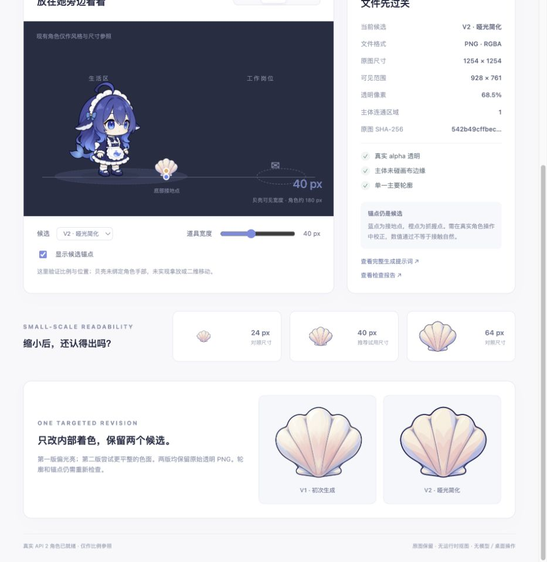

# 美术资源工作流：一次小规模试跑

状态：工作流样板已执行；首件为[资源表](../aliveness-art-assets.md)中的 O03 贝壳。这里只放设计与开发预览，不进入正式角色资源，也不修改现有 NPC／任务行为。

后续交付：[O03 可用资源与真实交互验收](o03-shell-interaction-v1/README.md)已将同一 PNG 放入 `web/props/shell/`，补齐手部绑定和实际拿放验证。以下“小规模试跑”结果及限制保留为第一轮记录，不替代后续验收结论。

动作制作接续：[O03 动作设计工作流](o03-shell-motion-v1/README.md)沿用这一个贝壳与现有分层模型，完成俯身拿起、携带、放下和收势；本地服务默认打开动作工作台，前两轮页面可通过各自路径继续访问。

当前工作台：[手型与遮挡补齐](o03-shell-hands-v1/README.md)保留三种候选手型原图，当前以单一网格连续开合与同帧物件合成修正换图闪烁和遮挡跳变；包含壳缘标定、实际闭合／张手门槛、像素回归及慢放闭环。服务默认打开这一版；各轮制作与验证记录分别保留。

## 流程

| 步骤 | 输入 | 产物 | 通过条件 |
|---|---|---|---|
| 1 需求卡 | 资源 ID、用途、风格、目标显示尺寸、禁止项 | `brief.md` | 一次只处理一个可判断的资源，注明与角色的尺寸／接触关系 |
| 2 基础生成 | 固定提示词，必要时明确标为风格参考的图片 | `prompt-v1.txt`、`shell-v1.png` | 原图与完整提示词保存；图像生成使用内置 image_gen，透明需求明确使用 true |
| 3 结构检查 | 原始 PNG | `inspection-v1.json` | 真 alpha、主体不碰边、单一主要连通区域；记录 SHA-256、可见范围与候选锚点 |
| 4 放回语境 | 结构报告、原图、基线角色 | 可交互预览 | 24／40／64 像素与浅／深／透明格对照，查看接地点和比例 |
| 5 单点修订 | 原图作为编辑目标、一个修改方向 | `prompt-v2.txt`、`shell-v2.png`、新报告 | 不覆盖旧图；重新检查透明度、边界及锚点，不假设编辑保持像素位置 |
| 6 评审交接 | 原图、提示词、数值检查、截图与观感记录 | `asset.json`、试跑记录 | 分别标明建议候选、结构通过、视觉观察与尚未完成的接触／绑定验证 |

生成本身通过内置工具完成，不能用本地脚本无凭证重跑。检查与预览可重复执行；没有添加模型 SDK、API key 或线上依赖。

## 本次使用

从仓库根目录执行，Node 版本沿仓库工具链：

```bash
node docs/design/art-workflow/inspect-art-asset.mjs \
  docs/design/art-workflow/o03-shell-v1/shell-v1.png \
  --output docs/design/art-workflow/o03-shell-v1/inspection-v1.json

node docs/design/art-workflow/inspect-art-asset.mjs \
  docs/design/art-workflow/o03-shell-v1/shell-v2.png \
  --output docs/design/art-workflow/o03-shell-v1/inspection-v2.json

node docs/design/art-workflow/preview-art-workflow.mjs
```

打开 [本地交互预览](http://127.0.0.1:4186/)。`PORT` 可选择其他端口；服务只监听 loopback，仅提供本试跑目录及已固定的上游角色静态资源，不暴露整个仓库或写入接口。退出终端进程后需重新启动。

检查器不修改图片，当前只支持不交错的 8-bit RGBA PNG。它检查透明度／几何，未实现 PNG chunk CRC 验证，浏览器解码和视觉检查独立进行；超规格输入明确拒绝。

## 本次结果

两次均使用内置 image_gen：第一次新建透明贝壳，第二次以第一版为编辑目标，只要求简化内部着色、减弱高光。具体提示词见[初次提示词](o03-shell-v1/prompt-v1.txt)与[修订提示词](o03-shell-v1/prompt-v2.txt)。

| 项目 | V1 | V2 |
|---|---|---|
| 原始画布 | 1254 × 1254 RGBA PNG | 1254 × 1254 RGBA PNG |
| 可见包围盒，alpha ≥16 | 924 × 756，起点 165,240 | 928 × 761，起点 163,238 |
| 完全透明像素比例 | 68.66% | 68.46% |
| 主要连通区域 | 1 | 1 |
| 可见边缘碰边 | 无 | 无 |
| 视觉观察 | 高光更光亮 | 色面更平整，内部沟线更明确 |
| 建议 | 保留作对照 | 推荐进入下一轮角色接触验证，非正式采用 |

浅色、深色、透明格、版本切换、40→64 像素调整和锚点显示／隐藏已在实际浏览器操作检查。24／40／64 像素对照均有渲染；40 像素是当前试用建议，24 像素的细部损失仍需真实场景审阅。

**学到的规则**：只修改着色也可能改变可见范围。本次包围盒宽增 4、高增 5 个原图像素，因此每个版本重新计算底部锚点；不把“保留轮廓”的提示词当像素对齐保证。预览仅按报告映射显示尺寸，没有裁切、改色或抠图重写原图。

结果预览：



角色参照沿真实 API 2 沙箱加载，通过本预览的 `reference-whale.js` 使用上游已有 raster 绘制选项，保证截图能捕获网格角色。仅用现有角色呼吸／站姿作比例参照，未新增角色美术、移动路线或拿物行为；没有以 CSS 平移冒充新身体能力。

## 本次不代表通过的项目

- 贝壳的抓握点仅为候选，未验证真实手／鳍接触、持物遮挡、放下和动作中断。
- 生成图是平面 PNG，未得到分层 PSD、骨骼或多方向原画；未通过角色分层资产验收。
- 结构检查不能判断全部语义、风格和权利归属；不自动宣告正式可分发。
- 没有运行或改变产品 NPC 行为，本轮不作为二维运动、原生桌面或 `test:inbox-ui` 的通过证据。

下一次可用同一需求卡格式制作 O01 小窝；涉及前后遮挡的资源应先验证分层输出能力，不能因为本次单张透明图顺利就推定复杂角色同样可行。
