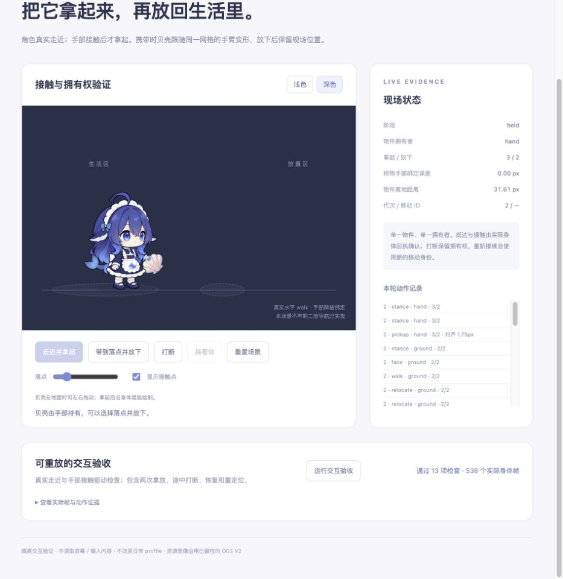

# O03 贝壳：可用资源与真实交互验收

状态：完成单屏水平场景的本地交互验证；尚未启用主产品自动生活、二维导航或原生桌面拿放。前一轮[生成与修订记录](../o03-shell-v1/brief.md)及 PNG 原字节继续保留。

## 交付资源

| 文件 | 内容 |
|---|---|
| [贝壳 PNG](../../../../web/props/shell/shell.png) | 1254×1254 RGBA，沿用已试过的 V2；未裁切、抠图或改色 |
| [资源规格](../../../../web/props/shell/asset.json) | 可见范围、UV、40px 试用宽度、真实接触标定后的抓握点／地面点、手臂绑定与遮挡顺序 |
| [拥有权策略](../../../../web/prop-interaction.js) | 走近、接触、拿起、携带、放低、放下、暂停、恢复和代次身份 |
| `figure.js` | 明确选用物件能力的隔离 body factory；真实 API 2 walk、到达回执和网格接触 |
| `scene-model.json` | 本场景使用的固定鲸鱼模型及物件规格快照，便于核对重现条件 |

PNG SHA-256：`542b49cffbec43e41b4ca75a0ae184302b1e384b27539ff957806c71d28b910d`。完整生成提示词是前一轮的 [V1](../o03-shell-v1/prompt-v1.txt) 与 [V2](../o03-shell-v1/prompt-v2.txt)，均使用内置 image_gen。本轮素材不需要重新生成，实际新增的是可使用的绑定规格、渲染层和交互逻辑。

路径中的 `../../../../web` 从本文件目录解析；本目录不随安装包分发，工作资源位于 `web/props/shell/`，主产品默认工厂未启用它。

## 真实接触如何成立

1. 原始 PNG 按可见包围盒映射 UV，不重写图片。抓握点由上一轮候选位置改为壳面上方实际可接触点，采用可见范围归一化坐标 `(0.5, 0.19)`。
2. 壳体和手共享 `armFar` 的变形链，持有时位于身体和前袖口之间；手部转动、坐立、呼吸和身体朝向都作用到同一个绘制结果。
3. 角色沿真实水平 walk 到位，ID 与实际 x 同时吻合才进入对齐。实际变形后的手部距离物件抓握点 ≤2px，且稳定四帧后才提交拿起。
4. 放下时先移动并放低手臂，实际物件地面锚点距场景地面 ≤2px 且稳定四帧后才释放。释放保留当帧的物件矩形变换，没有把角色旁边的另一个图标切换出来。
5. 中断停止本操作自己的 walkId、保留拥有权与目标；恢复发出新 ID。旧回执、错误抵达或缺失接触都不能完成拿放。超时进入可解释暂停，不以超时假定成功。

身体和物件的拥有权切换发生在同一绘制帧；原上游 model／texture 字节不变，固定 figure 的可选改动记录在 [UPSTREAM](../../../../web/upstream/UPSTREAM.md)。

## 使用和复现

在仓库根目录，使用 `.node-version` 与 `package.json` 指定的工具链：

```bash
node docs/design/art-workflow/o03-shell-interaction-v1/prepare-model.mjs --check
node docs/design/art-workflow/preview-art-workflow.mjs
```

打开 [默认交互入口](http://127.0.0.1:4186/)。本次验证实例使用 [4187 端口](http://127.0.0.1:4187/)，其启动方式为 `PORT=4187 node docs/design/art-workflow/preview-art-workflow.mjs`。

如果有意修改了模型或资源规格，先运行不带 `--check` 的 `prepare-model.mjs` 更新隔离快照，再重新验证并记录摘要。

- 点击贝壳或“走近并拿起”，也可用键盘激活按钮。
- 持有后设置落点并“带到落点并放下”；“打断／接着做”验证动作续接。
- 地面上的贝壳支持真实指针左右拖动，拖动不增加拿放次数；持有时不能把物件直接拖离手部。
- “运行交互验收”重置独立场景，驱动真实身体完成两次拿放、两处中断、恢复和重定位。脚本只发用户级指令，不注入到达或接触事件。

检查命令：

```bash
node node_modules/vitest/vitest.mjs run tests/prop-interaction.test.js
node docs/design/art-workflow/inspect-art-asset.mjs web/props/shell/shell.png \
  --binding web/props/shell/asset.json --output /tmp/o03-binding-check.json
npm run typecheck
npm test
npm run build
npm run test:inbox-ui
```

## 已验证结果

- 策略：8 项定向测试覆盖实际目标匹配、旧 ID、缺失接触、幂等、移动／操作中断、重定位、缺能力、超时和新代次。
- 真实身体：页面验收通过 13 项检查，实际观察 538 个身体帧。两次拿起接触距离约 1.72／0.39px，两次放下距地面约 0.61／0.64px，完整持物期间绑定误差 <0.01px，模型拥有权与绘制拥有权逐帧一致。
- 最终代码重放同样通过 13 项／538 帧，拿起约 1.72／0.40px、放下约 0.75／0.81px；见 `browser-qa-final.json`。PNG 的实际抓握像素 alpha=254，绑定点位于可见壳体内，见 `inspection-binding.json`。
- 浏览器实际操作：最终代码另行验证指针拖动不移动角色、不增减拿放计数，以及键盘发起拿起；见 `pointer-drag-final.json` 和 `keyboard-pickup-final.json`。长时间切出后的暂停保留手中物件，恢复后仍为持有状态。首轮记录 `browser-qa.json`、`pointer-drag.json` 和 `keyboard-pickup.json` 继续保留。
- 完整已有回归：`npm test`、`test:inbox-ui` 通过；类型与构建通过。具体运行环境与文件摘要见 `validation.json`。

本次先遇到沙箱对 `ps` 和 Chromium 启动的限制；在沙箱外使用固定工具链、测试临时 profile 完成既有回归，没有修改测试断言或产品权限。



## 验证范围

已验证的是指定主配色、180px 角色和 40px 贝壳下的本地浏览器交互。没有据此确认所有角色／配色／尺寸、物理多屏、混合 DPI、原生系统窗口、任意二维路径或完整生活／工作交接。该资源是单张物件贴图与绑定数据，不是完成了一套新角色分层美术。

主产品 NPC、任务完成、邀请与关系计分未开启此物件；没有新建成长入口。场景动作／坐标证据属于开发验证，不进入生产诊断摘要。本次未提交、发布或改动日常使用 profile。
