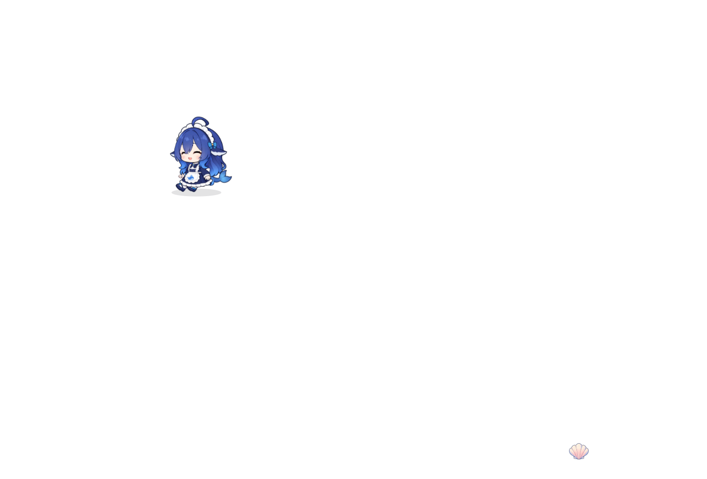

# D1 首个平面空间切片：固定验证

提交与测试身份映射见[验证清单](../evidence/2026-10-22-d1-plane/verification.json)。实现提交：`669b27c0459afe3f23a8803ea0d53ec774ed8b24`。本轮为未发布分支增量，不代表完整 D1、三平台或用户 LIVE 感验收。现行入口见[开发状态](../aliveness-development.md)，产品语义见[生活装配契约](../design/living-integration-contract.md)。

## 本轮实现

默认内置角色在支持的生活空间内，拖放及取消拖动停在合法平面位置；身体的支撑高度与跳跃离地高度分别处理，阴影跟随脚下。拖放产生本次角色运行的二维停靠点，缩放保留所在区域，观察路线跨越纵向区域后返回。贝壳及原整理目的地不随拖放瞬移，拿放拥有权与完成记录沿用既有协调器。

旧横向配置仍提供初始位置；重启、换角色或改 `npcHome` 清除临时停靠。关闭生活空间、自定义角色及小视口保留原回退。没有增加 OS 分支、窗口吸附、屏幕内容读取、第二个身体调度器或持久存档字段。方向素材未生成或绑定，仍使用原左右身体。

## 来源与测试环境

VM 测试源码是基线 `0ae35488af1b6349cd2d243d1628fa31a9453abf` 加固定补丁；SHA-256 为 `0cb131883c8166986778695e0b409d3be3fa5e18e8a6f83802a97a8371faf195`。传入前来宾干净，Git bundle 校验后快进至基线，再应用补丁；15 个文件逐一核对摘要后构建。原始[源码清单](../evidence/2026-10-22-d1-plane/source.json)和[补丁](../evidence/2026-10-22-d1-plane/source.patch)保留原字节。后补报告与入口整理不改变运行源码；实际交付代码与[原生报告](../evidence/2026-10-22-d1-plane/vm-native.json)中的代码及测试文件摘要一致。

- macOS 来宾：15.7.7（24G720）、arm64、1440×1080 虚拟显示，Tart 2.40.1；固定镜像摘要见[测试机说明](../macos-vm-testing.md)。
- 来宾及本机测试 Node 24.21.0、npm 11.19.1，Electron 44.7.0；复用已准备的依赖／浏览器，没有复制宿主 node_modules。
- 原生测试在来宾隔离 profile 串行执行；工作事实及用于有界恢复的键盘枚举受控，另存真实适配器观察。不能据此确认物理键盘可用。
- 本轮没有生成分发 tgz、日用安装或发布。源码构建、原生运行与正式安装分别结算。

## 结果

| 验证 | 结果与证据 |
|---|---|
| 核心策略、导航、接触、身体及几何 | 7 个文件、108 项通过，[日志](../evidence/2026-10-22-d1-plane/core.log) |
| TypeScript | 通过，[日志](../evidence/2026-10-22-d1-plane/typecheck.log) |
| 完整 `test:inbox-ui` | 通过：inbox 主脚本及 68 项 Node UI 用例（含 13 项生活／平面集成），[日志](../evidence/2026-10-22-d1-plane/inbox.log) |
| VM 默认产品原生生活 | 通过，实际拿放、工作停放／恢复、显式回应保存、平面拖放与跳跃中改尺寸；新停靠与返回均为 `(400, 394.6875)`。活动采样 144 个显示回调／144 个身体帧，[日志](../evidence/2026-10-22-d1-plane/vm-native.log)、[原始报告](../evidence/2026-10-22-d1-plane/vm-native.json) |
| VM 完整 `test:desktop` | 通过，多屏受控几何／断屏恢复、OS 光标与 CDP 点击、角色导入／重启、消息／设置、诊断、生命周期、崩溃恢复，[日志](../evidence/2026-10-22-d1-plane/vm-desktop.log) |

此图是隔离 VM 中透明产品窗口的画面，验证角色位于中上部；不代表已经感知或附着其他应用窗口。更多本机产物位于 `artifacts/runs/d1-plane-20261022-final/`，可能按后续保留策略回收；上列固定证据保留在 Git。

## 发现与修正

1. 跳跃中缩放曾沿用旧支撑高度。现按新视口重新映射支撑点并保留按角色比例换算的离地高度；三种尺寸和原生改尺寸均覆盖。
2. 持物在屏幕边缘停放后，光栅接触反算曾产生约 `0.000015px` 的越界，导致下一次拿取被严格导航拒绝。平面合法位置现留半像素余量，未放宽碰撞边界；持物拖放、关闭／重开生活空间后的真实恢复已回归。
3. 90px 首轮用例在尺寸尚未到达隔离 frame 时点击，现等待尺寸应用并使用实际命中轮廓。第一次本机浏览器启动被沙箱 MachPort 限制阻止，隔离无头浏览器经批准在宿主运行；原生桌面操作始终在 VM。
4. VM `test:desktop` 首次因缺少 `paper-star.zip` 测试夹具停止；按开发指南从本轮 `examples/star` 重新打包后通过。测试机指南补充了此准备步骤。

首轮失败日志在本轮独立 artifacts 目录保存，未改写为通过。通用桌面脚本仍有固定命名产物，本轮将对应原始输出取回 `vm-desktop/`；它们不与独立原生运行目录混用。未来执行前需按测试机说明保留已有固定产物。

## 剩余边界

真正的正面／背面／斜向站立、行走与转身仍待制作，最小样片规格见[素材入口](../design/aliveness-art-assets.md#d1-最小方向样片准备)。二维停靠暂不跨重启保存；窗口几何、附着与遮挡策略仍属于 D0 后续和 D2／D3。Windows／Linux 未在本轮实跑，物理多屏／键盘、真实 Host 模型、长期资源与用户自然度未验收。VM 结果不代签这些范围。
