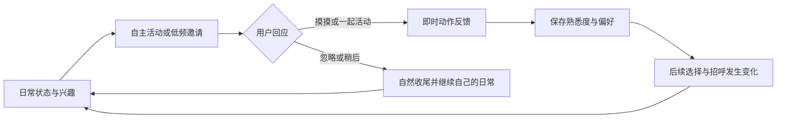

# 桌面伙伴路线图

更新：2026-10-16（Asia/Shanghai）。原 P1 自主陪伴及 0.4.10 诊断候选已实现，体验未通过；用户已认可[有限空间 NPC 日常的首步修订方向](npc-daily-life-plan.md)，本轮完成能力评估与文档更新，新行为尚未实现。P2／P3 和素材 A1–A3 尚未实施。实际交付、候选身份和检查结果统一见[文档索引](README.md)。

已执行的 P1 实施前缺口与拆分步骤已移至[规划快照](archive/2026-10-p1/roadmap-20261015.md)；当前行为以各契约为准。阶段编号不预定版本号或发布日期。

## 产品目标与完整循环

让桌宠在 Harness 运行、用户使用其他软件时，也有自己的日常；用户的回应会留下偏好，并逐渐改变它的行为。DSH 工作是共同活动之一。长期目标是用户能够察觉“它会自己生活，也越来越熟悉我”。

参考养成游戏的照料反馈、生活模拟游戏的自主决策与真实时间节奏：先让行为有动机、过程和结果，再扩展内容。增长表现为新反应、新习惯和共同经历；不采用缺席惩罚、连续签到、饥饿死亡或反复点击刷经验。核心日常、邀请和成长均在本地运行，功能测试不依赖模型返回。

当前首步目标是“从小窝出发，在有限空间内观察、移动、停留，遇到用户操作时退让，之后继续自己的安排”。忙碌时收缩空间、降低表达，空闲时恢复探索，运行期始终保留自己的日常状态。环境只取位置、鼠标、键盘活动、昼夜、工作事件及显式互动；能力依据、感知限制和退让规则由 [NPC 日常方案](npc-daily-life-plan.md)统一维护。

产品范围排除独立运行：宿主退出或插件停用后桌宠仍退出，不新增常驻服务、自启动器或独立账号。也不纳入 Computer Use、屏幕／前台内容采集、OCR、额外 Agent 调度、自动审批、天气新闻、定时模型闲聊、多宠同屏、商城及在线生图入口。GPT 生图用于开发期间制作素材，流程见[角色素材与建模计划](character-art-pipeline.md)。

## 阶段总览与依赖

| 阶段 | 用户能够感知的结果 | 交付范围 | 进入／退出条件 |
|---|---|---|---|
| P1 自主日常与最小关系闭环 | 不在 DSH 操作时，它会自己活动；偶尔邀请；回应会改变下一次招呼 | 三类日常、两种手动互动、一种邀请、可保存的熟悉度与一项行为解锁 | 按下文逐项通过；内置鲸鱼与缺词示例均能使用或合理退让 |
| P1 体验修订（待实现） | 有自己的小空间和连贯安排，忙碌时安静生活，之后能接续 | 小窝锚点、底边有限探索、键鼠及工作事件感知、情绪／意图保留、表现与任务仲裁；复用现有素材 | 先通过原语／输入能力检查，再实现并直接看见完整循环；当前能力探针不代表这项已通过 |
| P2 偏好与持续养成 | 相处方式不同，后来的主动选择也不同 | 多种偏好、玩具／零食、关系阶段、少量纪念物；扩展已建立的工作与日常共存规则 | P1 及体验修订技术与短时体验通过后，选择问题进入；偏好在独立时间线中产生可解释差异 |
| P3 共同经历与内容扩展 | 每隔一段时间有新鲜事，并能回看共同经历 | 有限本地探索事件、物件展示、季节内容、可选短游戏及用户触发的模型表达 | P2 有稳定内容制作与存档迁移流程；新内容分别验证重复率、打扰和资源成本 |

素材线依赖为：**A1 小道具／表情样板 → A2 分件、绑定与可导入角色包 → A3 配色、服装和内容模板**。A1 可单独开展；P1 不以新图为前提；P2 的持物、进食等具象互动必须通过 A2。素材线的图片、可动模型和安装验收分别结算，不能以一张生成图替代角色验收。

## P1：已实现的能力与维护入口

| 能力 | 当前实现 | 行为依据 |
|---|---|---|
| 三类日常与低频邀请 | `web/companionship.js`、`web/pet.js` | [自主陪伴契约](companionship-contract.md) |
| 真实抚摸／一起活动与熟悉招呼 | `web/companion-touch.js`、`web/companion-client.js` | [有效互动与关系](companionship-contract.md#有效互动与关系) |
| 有界关系存档与全局邀请预算 | `src/companion-store.ts`、`desktop/main.cjs` | [存档与权限](companionship-contract.md#存档与权限) |
| 模式持久配置与完整热同步 | `src/index.ts`、`src/bridge.ts`、`src/client/Settings.tsx` | [配置与运行](companionship-contract.md#配置与运行) |
| 默认关闭的诊断与外部资源观察 | `src/diagnostics.ts`、`scripts/sample-companion.mjs` | [诊断契约](diagnostics-contract.md) |

P1 使用现有 API 2 角色的观察、自娱、休息和熟悉招呼；不含玩具、进食、独立小游戏、多维偏好或新服装。模式、节奏、成长阈值、打断与存档规则以陪伴契约为准，用户开关组合见[使用指南](usage.md#自主陪伴p1-候选功能尚未发布)。

当前候选仍对活跃任务、待办、异常、阅读、草稿、在途发送、用户手势与休息强退让。用户新确定的 P1 体验修订会把基础工作共存提前：忙碌时退回小窝附近并保留日常安排，待办已呈现后允许有限安静活动。该变化尚未实现，需同步占用／呈现契约并回归；现有完成、提醒、已读和请求结算规则继续有效。

## P1：验收标准

“技术通过”和“体验通过”分别记录。2026-10-16 用户明确取消七天体验与填表要求，反馈当前候选基本没有“活”的感觉；当前候选的体验结论为未通过。后续采用短时可见演示及自然使用反馈，用户无需按天记录、打分或等待固定时长。原七天门槛保留在历史规划快照，不再作为当前进入条件；资源稳定性、跨日期存档与平台检查仍各自验证。

| 编号 | 可复现情境 | 通过标准 |
|---|---|---|
| P1-A 自主性 | 固定时间与随机源，内置鲸鱼，roam=true，无任务／会话；DSH 在后台 | 十分钟白天至少三类片段；同随机源下改变精力／兴致能改变选择倾向；每个片段有结束和复位；夜间只使用允许片段；宿主退出桌宠仍退出 |
| P1-B 邀请 | 推进到候选时机；分别接受、忽略、稍后、今天安静 | 最多一个邀请；10 秒忽略后结束；冷却、每日两次预算和跨重启抑制均有效；零系统通知、零模型请求、不改变焦点 |
| P1-C 互动真实性 | 真实抚摸、键盘发起活动、重复触摸、动作预览、任务庆祝及伪造触摸 | 仅真实且完成的两类互动计入；固定环境下每类 20 次，至少 95% 在输入后 500ms 内可见反馈；重复／预览／自动动作不计入，不发聊天消息 |
| P1-D 成长连续性 | 跨三个本地日期累计六次，原生重启／Host 重启、换配色、同 id 包更新 | 解锁一次、后续招呼可见变化；有效记录不重复；换角色隔离；离开七天、忽略邀请和今天安静均不降级 |
| P1-E 打断与恢复 | 日常或邀请途中插入任务、审批、阅读、输入、拖拽、隐藏、锁屏或休眠 | 下次调度取消，500ms 内撤去邀请并停止发起后续步骤；动作在 P1-0 固定的上限内安全释放，空中／用户手势不强制复位；可恢复后 500ms 内应用任务神态。休眠期间不要求执行回调，恢复首步取消；不补播，之后等待完整间隔 |
| P1-F 原有体验 | 热切模式、字号、角色与语言；长回复阅读、输入选区及在途发送 | 阅读 DOM／正文与滚动、草稿／焦点／选区、请求身份和原气泡时钟保持；零新增 read/select/chat；任务完成仍由共享完成语义决定 |
| P1-G 能力与设置 | 缺词角色、`roam=false`、减少动态效果、旧配置、关闭模式 | 不发送不支持的词；不可完成的片段不计成长；自动路径退让；旧默认行为保持；切换后始终只有一个闲时动作拥有者 |
| P1-H 存档健壮性 | 写入失败／崩溃、重复请求、迟到旧写入、同目录多实例、损坏／未来 schema、午夜／时区变化／时钟回退 | 有界记录、单写者、原子写、修订保护和幂等成立；未确认写入不显示持久成功；换角色也不能刷邀请预算；原损坏文件保留 |
| P1-I 技术矩阵 | 策略与存档测试、浏览器、原生、正式同包安装 | 现有三平台检查和两版 Host 六组安装全部通过；物理多屏、锁屏／休眠及通知中心实机结果分别标记 |
| P1-J 日常价值 | 工程侧先做短时可见场景检查，再由用户自然使用并随手反馈；不设七天时长或记录表 | 用户无需查看计数就能察觉不同自主行为及过程／收尾，有连续的日常感；可随时拒绝且没有追问、不妨碍工作。明显无感即可判未通过并调整，自动计数不能替代体验结论 |

初始资源门槛：同机、同角色 180px、同包、同宿主，固定随机脚本对比陪伴关闭／白天／夜间，20 秒预热后各至少三轮 60 秒；相对关闭时，平均 CPU 增量不超过单核 **1 个百分点**、平均进程树 RSS 增量不超过 **32 MiB**。另做两小时观察，最后半小时平均 RSS 比预热后首半小时增加不超过 **20 MiB**，队列、去重集合和存档不持续无界增长。该预算已在产品实现前冻结，后续采样和失败记录均保留在 P1 记录。

[`scripts/measure-idle.mjs`](../scripts/measure-idle.mjs) 已扩展 `off`／`companion-day`／`companion-night` 的真实时间采样；当前 `ps` 采样只支持 macOS/Linux，Windows 资源测量需另补采样器或独立报告未验收，不能由三平台正确性 CI 推定资源通过。

验证沿用 `npm run typecheck`、`npm test`、`npm run build`、`npm run test:ui`、`npm run test:notification-ui`、**`npm run test:inbox-ui`**、`npm run test:desktop` 与 `npm run test:install`；涉及新角色再执行 `npm run character:pack -- <角色目录> <输出.zip>`。新增策略／存档案例接入已有测试入口，不提前声称存在新的 npm 命令。系统桌面操作串行，原生及安装使用隔离 profile。行为／邀请次数和资源由本地工具采集，用户的自然反馈直接作为体验证据，不要求填表或引入遥测。

## P2 与 P3 的扩展约束

P2 让“不同照料产生不同后续选择”：先增加玩耍／安静陪伴两种偏好，沿用 P1 的事件与存档版本迁移；通过两组不同互动历史、相同随机源的回放验证选择权重和反应确实不同。增加玩具、零食及少量纪念物时，每个物件同时具有素材、动作、有效互动和解锁说明。关系内容按小批次增加，不依赖 DSH 消耗量、token 或付费行为。

基础工作共存已前移至 P1 体验修订；P2 在其通过后扩展偏好与内容，不把长期冻结作为基线。新审批／错误优先、长期待办保留入口，以及再次提醒如何打断，仍须由占用／呈现契约明确并回归 broker、阅读及完成语义；不能仅通过放宽某个条件绕过旧保护。

P3 的探索只发生在宠物的虚构世界，本地计时生成有限结果，不能暗示看过用户文件或替用户执行过工作。宿主关闭期间不运行；如以后增加“回来后的探索结果”，只在重启时有上限地结算，不补播、不惩罚缺席。节日内容无必须当天领取的损失。模型表达只在另行明确范围后接入，不成为日常调度、存档和验收的依赖。

## 已交付基础与其他候选

M1–M6 已纳入 v0.4.9，继续作为上述实施的回归基线；历史阶段安排保留在[归档路线图](archive/2026-10-m1-m6/roadmap.md)。

| 项目 | 行为与维护入口 | 历史验收 |
|---|---|---|
| M1 完成语义 | [提醒契约](notification-contract.md) | [M1](evidence/m1/README.md) |
| M2 会话续接 | [会话契约](session-chat-contract.md) | [M2](evidence/m2/README.md) |
| M3 异常恢复 | [恢复契约](desktop-recovery-contract.md) | [M3](evidence/m3/README.md) |
| M4 文字可读性 | [文字契约](text-readability-contract.md) | [M4](evidence/m4/README.md) |
| M5 多屏适配 | [多屏契约](multi-display-contract.md) | [M5](evidence/m5/README.md) |
| M6 日常节奏 | [日常节奏契约](daily-rhythm-contract.md) | [M6](evidence/m6/README.md) |

桌宠内简单提问直答、阅读增强、版本／资源反馈仍为独立候选，不混入 P1。角色制作体验纳入素材线，继续使用 API 2 与现有 ZIP 导入；上游 main 的新内容不自动进入本仓库固定运行时。

每项实施同步契约、实现、测试和使用说明。新增验收记录绑定完整源码提交、宿主版本和实际包摘要；保留历史原始报告／素材字节，自动化、实机和长期体验分别结算。版本修改与对外发布遵循[发布流程](releasing.md)，本次规划不改变已发布产物身份。
