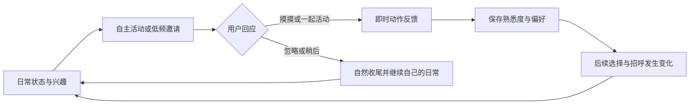

# 桌面伙伴路线图

更新：2026-10-15（Asia/Shanghai）。方案基于当前源码 `e2c7e39b97723f69fd77a209d93958a8e04aea30` 和用户本轮需求整理；**P1 代码、本机回归、两版宿主同包安装及短时资源预算已完成，完整验收尚待远端／实机／长期检查，进度见 [P1 记录](evidence/p1/README.md)，工作区规则见[陪伴契约](companionship-contract.md)；P2／P3 与素材 A1–A3 尚未实施**。当前分发版本仍是 v0.4.9，交付证据见[文档索引](README.md)。已交付行为继续以现行契约为准，阶段编号不预定版本号或发布日期。

## 产品目标与完整循环

让桌宠在 Harness 运行、用户使用其他软件时，也有自己的日常；用户的回应会留下偏好，并逐渐改变它的行为。DSH 工作是共同活动之一。长期目标是用户能够察觉“它会自己生活，也越来越熟悉我”。

参考养成游戏的照料反馈、生活模拟游戏的自主决策与真实时间节奏：先让行为有动机、过程和结果，再扩展内容。增长表现为新反应、新习惯和共同经历；不采用缺席惩罚、连续签到、饥饿死亡或反复点击刷经验。核心日常、邀请和成长均在本地运行，功能测试不依赖模型返回。

本轮明确排除独立运行：宿主退出或插件停用后桌宠仍退出，不新增常驻服务、自启动器或独立账号。也不纳入 Computer Use、屏幕／前台内容采集、OCR、额外 Agent 调度、自动审批、天气新闻、定时模型闲聊、多宠同屏、商城及在线生图入口。GPT 生图用于开发期间制作素材，流程见[角色素材与建模计划](character-art-pipeline.md)。

## 实施前的基础与缺口

| 当前代码 | 可复用的能力 | 本轮要解决的缺口 |
|---|---|---|
| [`web/daily-rhythm.js`](../web/daily-rhythm.js) | 可注入时间、随机源、占用和词表的纯策略；昼夜间隔、打断、复位 | 仅四种随机轻动作，无连续活动、关系状态和互动后果 |
| [`web/pet.js`](../web/pet.js) | `updateRhythm`、`updateMood`、`onBody`；阅读、通知、拖拽及悬停仲裁 | 活动与任务神态紧耦合；任务、待办、异常可以长期阻止日常；缺少邀请入口 |
| [`web/upstream/kit/body.js`](../web/upstream/kit/body.js)、[`body-host.js`](../web/upstream/body-host.js) | 共享动作、物理、视线；经过输入门控的触摸事件；API 2 沙箱 | 不能把自动动作、动作预览或沙箱自行声称的事件算作真实照料 |
| [`src/index.ts`](../src/index.ts)、[`src/bridge.ts`](../src/bridge.ts)、[`src/client/Settings.tsx`](../src/client/Settings.tsx) | 持久配置与完整热同步；宿主会话、请求和回执 | 陪伴模式与邀请设置需贯穿同一路径，不能只存在 Renderer |
| [`desktop/main.cjs`](../desktop/main.cjs)、[`src/character-store.ts`](../src/character-store.ts) | 原生生命周期、隔离 profile；角色包和外观的持久保存 | 尚无熟悉度／偏好的专用存储；现有角色选择记录不能充当养成存档 |
| [`web/upstream/whale/`](../web/upstream/whale/)、[`examples/star`](../examples/star) | 网格角色、完整表情动作、SVG 示例与角色打包入口 | 第一阶段可复用；道具、进食和新服装需要绘制与动作制作 |

当前 `dailyRhythm=false`，旧路径为 calm 漫游；开启后会关闭自由漫游并使用四种有限动作。仅调整随机间隔不足以形成养成循环。新方案不直接把现有布尔值解释成允许主动邀请。

## 阶段总览与依赖

| 阶段 | 用户能够感知的结果 | 交付范围 | 进入／退出条件 |
|---|---|---|---|
| P1 自主日常与最小关系闭环 | 不在 DSH 操作时，它会自己活动；偶尔邀请；回应会改变下一次招呼 | 三类日常、两种手动互动、一种邀请、可保存的熟悉度与一项行为解锁 | 按下文逐项通过；内置鲸鱼与缺词示例均能使用或合理退让 |
| P2 偏好与持续养成 | 相处方式不同，后来的主动选择也不同 | 多种偏好、玩具／零食、关系阶段、少量纪念物；治理长期待办对日常的阻塞 | P1 技术验收与七天实用反馈完成后，选择问题进入；偏好在独立时间线中产生可解释差异 |
| P3 共同经历与内容扩展 | 每隔一段时间有新鲜事，并能回看共同经历 | 有限本地探索事件、物件展示、季节内容、可选短游戏及用户触发的模型表达 | P2 有稳定内容制作与存档迁移流程；新内容分别验证重复率、打扰和资源成本 |

素材线并行推进：**A1 小道具／表情样板 → A2 分件、绑定与可导入角色包 → A3 配色、服装和内容模板**。A1 可与 P1 并行，但 P1 不以新图为前提；P2 的持物、进食等具象互动必须通过 A2。素材线的图片、可动模型和安装验收分别结算，不能以一张生成图替代角色验收。

## P1：第一阶段范围

### 体验与内容

| 项目 | 必做范围 | 明确延后 |
|---|---|---|
| 自主日常 | 三类：观察（张望／点头）、自娱（开心／短舞）、休息（坐下／打盹）；每类至少一个 2–3 步片段，有起因、收尾和打断规则 | 跳跃／自由移动、玩具追逐、进食、小窝、桌面物体识别 |
| 用户互动 | 复用真实抚摸 `pet`；增加可键盘操作的“一起活动”入口。两者分别有即时动作反馈；不改变双击聊天、单击戳碰和拖拽语义 | 独立小游戏、货币、背包和照料数值面板 |
| 主动邀请 | 一种“陪我活动一下”邀请，提供“一起／稍后／今天安静”；不抢焦点，10 秒无回应自然结束 | 主动发模型消息、系统通知、多个事件并发 |
| 最小养成 | 保存有效互动、熟悉度、邀请预算及安静偏好；解锁一次“更熟悉的招呼”，让下一次主动邀请有可见变化 | 多维性格、大量等级、复杂习惯学习和经历日志 |
| 运行范围 | Harness 保持运行、无需 DSH 窗口处于前台；支持无会话及所有会话均空闲的状态 | 宿主退出后继续运行；判断用户正在其他软件做什么 |

“打盹”是策略拥有且可结束的自动活动，“用户休息”仍由用户拥有。前者结束不能唤醒后者。日常片段使用角色实际支持的词；`walk` 等移动仅在角色声明 `can.walk` 且提供对应能力时启用。没有某类能力时跳过并说明可用范围，不能用无效命令假装完成。

### 初始节奏与成长规则

以下是 P1 的可测初始规则，实施前写入新陪伴契约；后续调参必须保留变更理由和体验记录。

- 内部动机：P1 只维护有界的瞬时精力和兴致，按可见且可用的运行时间缓慢变化；自娱消耗精力、提升兴致，休息恢复精力，久未活动提高自娱倾向。用它们和昼夜、最近活动为候选片段评分，再在合格候选中加权选择；低精力偏休息、高兴致可安静观察。具体曲线在 P1-0 固定，用相同随机源、不同状态的回放证明权重差异。这两项不是待喂养的生存值，不因离线衰减；重启可恢复中性值，长期熟悉度另行保存。
- 自主活动：沿用 07:00–22:00／22:00–07:00 本地时段；白天完整片段之间等待 45–90 秒，夜间 120–240 秒且只选观察／休息。单片段不超过 20 秒。无阻塞、全词表、固定随机种子的十分钟白天脚本至少覆盖三类片段，避免相邻重复同一片段。保留“等待”选择。
- 邀请：开启后的首次启动、恢复、解除占用均不立即邀请；白天连续可用满 30 分钟才进入候选，此后每 30–60 分钟可尝试一次，按本地日期最多两次。它是上限而非每天必达的任务；夜间、隐藏、锁屏和休眠不邀请。没有回应即结束并重新等待，不排队补发。
- “稍后”取消本次并至少冷却 60 分钟；“今天安静”禁用邀请至下一个本地日期，跨重启保留；保留用户手动恢复入口。安静不清除关系，也不关闭任务通知；完全关闭陪伴后沿原 M6／calm 路径运行。
- 抚摸与一起活动各自必须实际发生／完成后，才形成有效互动。连续抚摸合为一次，五分钟内不重复计入成长；每个本地日期最多计入三次。用户选择“一起”与其完成动作共用同一互动身份，只结算一次。
- 在至少三个不同本地日期累计六次有效互动后，解锁一次熟悉招呼：支持时由普通 `wave` 变为 `wave → love`，在挥手后出现爱心；缺少 `love` 时保留普通招呼，宿主的可访问状态文字能说明已解锁。后续邀请仍受同一预算约束。关系阶段只增不减；缺席、拒绝和时间回退不扣分。
- 暂停／不可用时间不计入互动或成长，不补算离线收益。日期回退不能重置已消耗的预算；时区变化、跨午夜和长调度中断有专门测试。计时间隔用单调时间，持久日期及已结算互动由存档校验，不能依赖 Renderer 定时器重启来防刷。

### 与工作、阅读和旧设置的关系

P1 保留当前工作优先规则：活跃任务、审批／提问、异常神态、阅读、输入草稿及在途发送、菜单／角色面板、拖拽／物理动作、悬停入口、用户休息、减少动态效果均阻止自主活动和邀请。任务开始立即取消当前自有片段／邀请，恢复任务神态；解除后重新等待完整间隔。用户主动触发的互动也不能覆盖任务与阅读占用。

因此，**P1 解决“宿主在后台且没有工作占用时仍像桌宠”**；有长期待办或后台任务时仍会退让。P2 再以“新工作事件先呈现，已呈现的待办保留入口，有限轻活动可以恢复”为设计课题，修改[提醒](notification-contract.md)、[日常节奏](daily-rhythm-contract.md)及[角色状态映射](characters.md)后实现，不能在 P1 偷换这些语义。

设置新增 `companionship: off | quiet | interactive`，默认 `off`；`quiet` 开启自主日常及用户主动互动，`interactive` 额外允许邀请。模式开启时由新策略独占闲时动作，关闭时恢复旧 `dailyRhythm`／calm 配置；热切换不能同时运行两套调度器。`roam=false` 继续禁止自主动作和邀请，不改变用户手势；减少动态效果保留必要文字与手动入口，跳过自动动作和邀请。旧配置不会因升级而新增邀请，用户可明确选择启用。

陪伴模式、任务通知和音效分别设置：关闭任务通知不代表允许邀请，今天安静不代表关闭任务提醒。中英文配置、菜单及可访问名称同步维护；设置页现有 `save` 参数仅接受 number／boolean，新增枚举时同步调整表单类型、保存逻辑与本地化，不能只加一个下拉框。

## P1：实现拆分与存档

下列模块已进入 P1 实施；路径的实际落地和验证结果见陪伴契约及 P1 记录。未增加独立运行或生图命令。

| 顺序 | 改动位置 | 结果与接口约束 |
|---|---|---|
| P1-0 固定契约与基线 | 新增 `docs/companionship-contract.md`，同步日常／恢复／角色契约；固定现有功能和资源基线 | 先确定模式、有效互动、预算和打断语义；实测候选动作的结束／取消能力，为每种动作固定最长安全释放时间；现行契约在实现完成前继续有效 |
| P1-1 日常决策 | `web/companionship.js` 与类型声明；接入 `web/pet.js` | 一个纯决策模块接收时间、占用、角色能力和关系摘要，输出下一步意图、释放及互动结果；内部管理评分、去重、冷却、片段进度，不向 UI 暴露计时细节 |
| P1-2 邀请与反馈 | `web/pet.js`、`web/index.html`、样式、`web/locale.js` | 独立的陪伴邀请视图，复用现有位置与占用计算；不混入任务收件箱、`TaskNotice` 或会话回复集合 |
| P1-3 存档与配置 | `src/companion-store.ts`；`desktop/main.cjs`／`preload.cjs`；Host 配置与设置页；[`scripts/build.mjs`](../scripts/build.mjs)、[`scripts/preview.mjs`](../scripts/preview.mjs)、[`src/figure-server.ts`](../src/figure-server.ts) | 模式走现有完整配置链；养成存档由原生 main 单点拥有，经校验后的有限接口读写；新增存档模块纳入 CJS 构建，浏览器预览增加隔离数据的本地服务适配器与受限路由 |
| P1-4 回归与实用 | 现有策略、浏览器、原生和安装测试入口；新增对应案例 | 通过下方验收矩阵后进行七天实用；结果分别记录，不将自动化结果写成体验结论 |

角色仅负责通过现有 API 2 绘制与执行动作。策略不新增物理引擎，不直接操作角色 iframe 内部 DOM，不向角色包开放存档或 Electron 权限。移动通过现有 `walk/stopWalk` 与完成／中断事件驱动，其他步骤使用 `do`、`done` 及有界超时；取消只释放当前策略拥有的动作，不能清除随后发生的用户手势。当前接口没有通用 `cancel`，不能假设 `neutral` 能取消跳跃或短手势；优先选可安全收尾的动作，必要的 kit 适配需单独记录和回归。策略要区分自己发起的 `body.busy` 与外部物理占用，防止片段刚开始就取消自己；旧活动代次的 `done/arrived` 不能推进新片段。

存档放在 Electron profile 的实际 `userData` 下，独立于内容寻址的角色包目录；测试显式使用隔离目录，不假设现有路径已按 Harness profile 隔离。关系按角色 `id` 保存，换配色／更新同 id 包不重置，换角色不串档；删除导入角色时一并删除其关系档，失败时保留可重试诊断。邀请每日预算和今天安静按 Electron profile 共享，切换角色不能重置。P1 只保存 schema 版本、存档修订、熟悉度、有效互动汇总／有界去重记录、解锁集合、邀请计数和安静截止日期。日期记录保留防回退水位，集合与记录均有界。

邀请在实际显示前先原子预留预算，崩溃可能少邀请一次，不能重启后超额。互动写入采用串行校验与临时文件替换；旧修订写入拒绝覆盖新状态。同 `userData` 的多进程需保证单写者，拿不到写锁的实例禁用邀请和持久成长，不影响原任务功能；单靠原子替换不能解决多实例覆盖。Renderer 初始化只恢复关系摘要，不恢复旧邀请、旧活动、草稿或聊天输入；没有收到写入成功回执时，不展示已保存／已解锁。损坏或未知未来 schema 保留原文件并降级为不持久成长，给出有界提示；不得悄悄覆盖原档。首次无档才创建新档。

## P1：验收标准

“技术通过”和“七天体验通过”分别记录。以下为验收门槛，逐项执行状态见 P1 记录，未执行的远端／实机／长期检查继续保留。

| 编号 | 可复现情境 | 通过标准 |
|---|---|---|
| P1-A 自主性 | 固定时间与随机源，内置鲸鱼，无任务／会话；DSH 在后台 | 十分钟白天至少三类片段；同随机源下改变精力／兴致能改变选择倾向；每个片段有结束和复位；夜间只使用允许片段；宿主退出桌宠仍退出 |
| P1-B 邀请 | 推进到候选时机；分别接受、忽略、稍后、今天安静 | 最多一个邀请；10 秒忽略后结束；冷却、每日两次预算和跨重启抑制均有效；零系统通知、零模型请求、不改变焦点 |
| P1-C 互动真实性 | 真实抚摸、键盘发起活动、重复触摸、动作预览、任务庆祝及伪造触摸 | 仅真实且完成的两类互动计入；固定环境下每类 20 次，至少 95% 在输入后 500ms 内可见反馈；重复／预览／自动动作不计入，不发聊天消息 |
| P1-D 成长连续性 | 跨三个本地日期累计六次，原生重启／Host 重启、换配色、同 id 包更新 | 解锁一次、后续招呼可见变化；有效记录不重复；换角色隔离；离开七天、忽略邀请和今天安静均不降级 |
| P1-E 打断与恢复 | 日常或邀请途中插入任务、审批、阅读、输入、拖拽、隐藏、锁屏或休眠 | 下次调度取消，500ms 内撤去邀请并停止发起后续步骤；动作在 P1-0 固定的上限内安全释放，空中／用户手势不强制复位；可恢复后 500ms 内应用任务神态。休眠期间不要求执行回调，恢复首步取消；不补播，之后等待完整间隔 |
| P1-F 原有体验 | 热切模式、字号、角色与语言；长回复阅读、输入选区及在途发送 | 阅读 DOM／正文与滚动、草稿／焦点／选区、请求身份和原气泡时钟保持；零新增 read/select/chat；任务完成仍由共享完成语义决定 |
| P1-G 能力与设置 | 缺词角色、`roam=false`、减少动态效果、旧配置、关闭模式 | 不发送不支持的词；不可完成的片段不计成长；自动路径退让；旧默认行为保持；切换后始终只有一个闲时动作拥有者 |
| P1-H 存档健壮性 | 写入失败／崩溃、重复请求、迟到旧写入、同目录多实例、损坏／未来 schema、午夜／时区变化／时钟回退 | 有界记录、单写者、原子写、修订保护和幂等成立；未确认写入不显示持久成功；换角色也不能刷邀请预算；原损坏文件保留 |
| P1-I 技术矩阵 | 策略与存档测试、浏览器、原生、正式同包安装 | 现有三平台检查和两版 Host 六组安装全部通过；物理多屏、锁屏／休眠及通知中心实机结果分别标记 |
| P1-J 日常价值 | 在本人电脑七天实用，其中至少三天有 30 分钟以上 DSH 后台且无任务占用 | 能举出三类自主行为、一项相处后变化；能随时拒绝且没有追问；记录邀请次数／响应／重复感及每日打扰评分。最后三天“像有自己日常”均 ≥4/5、“打扰”均 ≤2/5，否则继续调整后复验 |

初始资源门槛：同机、同角色 180px、同包、同宿主，固定随机脚本对比陪伴关闭／白天／夜间，20 秒预热后各至少三轮 60 秒；相对关闭时，平均 CPU 增量不超过单核 **1 个百分点**、平均进程树 RSS 增量不超过 **32 MiB**。另做两小时观察，最后半小时平均 RSS 比预热后首半小时增加不超过 **20 MiB**，队列、去重集合和存档不持续无界增长。该预算已在产品实现前冻结，后续采样和失败记录均保留在 P1 记录。

[`scripts/measure-idle.mjs`](../scripts/measure-idle.mjs) 已扩展 `off`／`companion-day`／`companion-night` 的真实时间采样；当前 `ps` 采样只支持 macOS/Linux，Windows 资源测量需另补采样器或独立报告未验收，不能由三平台正确性 CI 推定资源通过。

验证沿用 `npm run typecheck`、`npm test`、`npm run build`、`npm run test:ui`、`npm run test:notification-ui`、**`npm run test:inbox-ui`**、`npm run test:desktop` 与 `npm run test:install`；涉及新角色再执行 `npm run character:pack -- <角色目录> <输出.zip>`。新增策略／存档案例接入已有测试入口，不提前声称存在新的 npm 命令。系统桌面操作串行，原生及安装使用隔离 profile。体验记录由用户本地自愿记录，不引入遥测。

## P2 与 P3 的扩展约束

P2 让“不同照料产生不同后续选择”：先增加玩耍／安静陪伴两种偏好，沿用 P1 的事件与存档版本迁移；通过两组不同互动历史、相同随机源的回放验证选择权重和反应确实不同。增加玩具、零食及少量纪念物时，每个物件同时具有素材、动作、有效互动和解锁说明。关系内容按小批次增加，不依赖 DSH 消耗量、token 或付费行为。

P2 还要验证工作事件与日常的共存：新审批／错误优先，已呈现的长期待办用持续入口表达；允许哪些轻活动恢复、多久恢复、再次提醒如何打断，必须写入契约并回归 broker、阅读及完成语义。P1 的强退让规则是兼容边界，不是最终产品体验。

P3 的探索只发生在宠物的虚构世界，本地计时生成有限结果，不能暗示看过用户文件或替用户执行过工作。宿主关闭期间不运行；如以后增加“回来后的探索结果”，只在重启时有上限地结算，不补播、不惩罚缺席。节日内容无必须当天领取的损失。模型表达只在另行明确范围后接入，不成为日常调度、存档和验收的依赖。

## 已交付基础与其他候选

M1–M6 已纳入 v0.4.9，继续作为上述实施的回归基线；历史阶段安排保留在[归档路线图](archive/2026-10-m1-m6/roadmap.md)。

| 项目 | 行为与维护入口 | 历史验收 |
|---|---|---|
| M1 完成语义 | [提醒契约](notification-contract.md) | [M1](evidence/m1/README.md) |
| M2 会话续接 | [会话契约](session-chat-contract.md) | [M2](evidence/m2/README.md) |
| M3 异常恢复 | [恢复契约](desktop-recovery-contract.md) | [M3](evidence/m3/README.md) |
| M4 文字可读性 | [文字契约](text-readability-contract.md) | [M4](evidence/m4/README.md) |
| M5 多屏适配 | [多屏契约](multi-display-contract.md) | [M5](evidence/m5/README.md) |
| M6 日常节奏 | [日常节奏契约](daily-rhythm-contract.md) | [M6](evidence/m6/README.md) |

桌宠内简单提问直答、阅读增强、版本／资源反馈仍为独立候选，不混入 P1。角色制作体验纳入素材线，继续使用 API 2 与现有 ZIP 导入；上游 main 的新内容不自动进入本仓库固定运行时。

每项实施同步契约、实现、测试和使用说明。新增验收记录绑定完整源码提交、宿主版本和实际包摘要；保留历史原始报告／素材字节，自动化、实机和长期体验分别结算。版本修改与对外发布遵循[发布流程](releasing.md)，本次规划不改变已发布产物身份。
